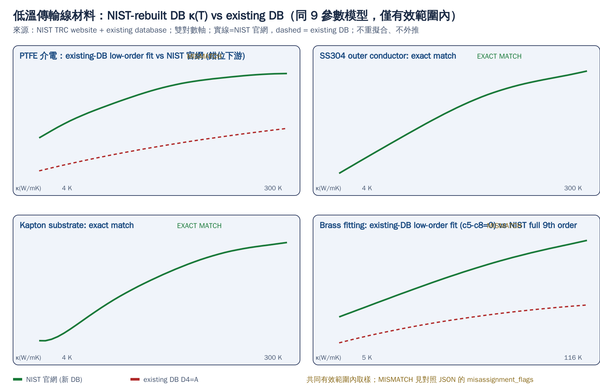
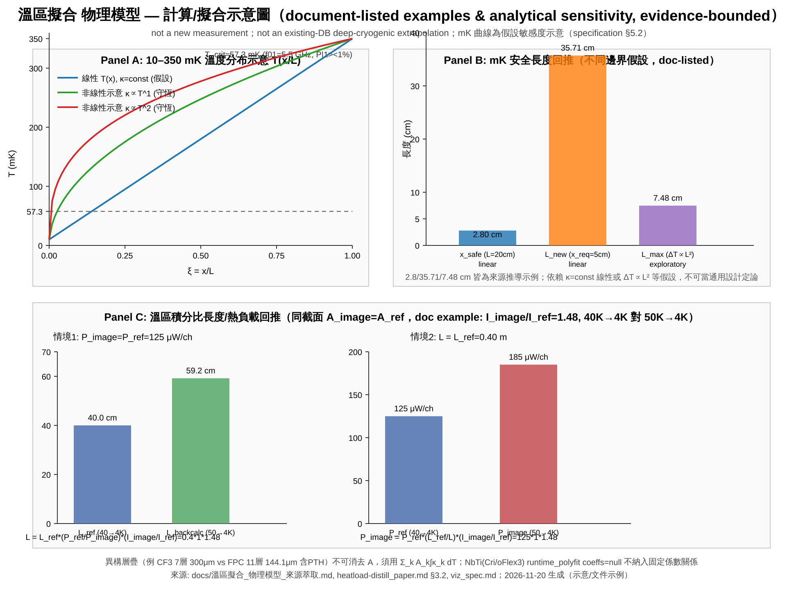

# 溯源作為可量測性質：重建超導互連的低溫熱導率資料

**呂俊興 (Chun Hsing Lu)**  
Uleam Inc., Taoyuan city, Taiwan  
**通訊作者：** 呂俊興，josh.lu@u-leam.com

<!--
> **稿件類型：** Nature-style 回顧／方法投稿稿件  
> **對應英文稿：** `heatload_distill_submission.md`（同一篇論文之 EN 版；章節/邏輯/數值/公式/引用/邊界對齊）。  
-->
> **日期：** 2026-11-20  
> **證據邊界：** 所有主張皆來自可公開追溯的材料物性資料、已驗證期刊文獻與區間內曲線比對。不重擬合、不新量測、不編造係數或引用。  
> **說明：** 本中文版與英文投稿稿在章節、邏輯、數值、公式、引用與邊界宣告上高度一致，僅語言表述與必要排版不同。

## 摘要

超導微波互連的低溫熱負載估算仰賴擬合的熱導率函數 κ(T)，然而係數的溯源、有效範圍與製程依賴在資料重用時往往流失。我們展示：係數資料庫的內部數學自洽並不意味材料可靠——一個含 53 筆固定係數條目的資料庫通過所有結構與區間內行為檢查（SSOT 固定係數集合的結構/範圍驗證，與另行執行之新 NIST DB 驗證不同），卻含有兩筆疑似係數誤植與多筆低階理想化擬合。透過從 NIST 低溫材料性質官網重建一個獨立資料庫，並在同一九參數 log-log 模型下與既有真相來源比對，我們發現四筆完全一致（Kapton、不鏽鋼 304/304L/316）——此處「一致」指其係數匹配 NIST 通用擬合，是來源忠實度的陳述，而非材料特定有效性的驗證——其餘則在擬合範圍內顯著偏離——PTFE 在 293 K 差 358%，黃銅在 77 K 差 986%。我們將這些偏離追溯至低階佔位擬合與交叉誤植（尼龍承接 PTFE 係數、Mylar 承接尼龍係數）。結果把資料溯源重新框架為可量測、可稽核的性質，而非假設，並提供一個在 nW 級熱預算中使用低溫熱導擬合的有限工作流。

**關鍵詞：** 低溫熱導率、溯源、熱負載估算、稀釋冷凍機、超導互連、數值條件性、資料可靠度

## 1. 緒論

### 1.1 背景與重要性
超導量子處理器需要從室溫延伸至稀釋冷凍機毫開耳文混合腔的微波控制線。每條線攜帶的被動傳導熱負載在 nW 至 µW 量級，直接限制各溫階可用的製冷功率。近期高密度佈線努力說明了這一點：Smith *et al.* 回報 1 英呎柔性 Nb–47 wt% Ti 同軸帶狀線（FLAX）從 1 K 至 100 mK 每條跡線約 5 nW，約為最小商用超導同軸線計算熱負載的一半 [1]。此類估算對使用哪些 κ(T) 資料、在什麼溫度範圍、以及擬合在範圍外如何行為都很敏感。

### 1.2 問題：把自洽誤當可靠
從低溫到室溫的熱導率跨越數個數量級，通常以緊湊擬合形式表示。九係數 log-log 多項式 log₁₀κ(T)=Σ cₙ(log₁₀T)ⁿ，以及高純度銅的來源特定有理形式，透過低溫材料資料庫散播並在熱預算模型中重用。資料庫可以內部自洽——每條曲線皆為正、有限、光滑、可積分——卻仍帶有誤植、在不同範圍擬合、或理想化為低階佔位的係數。當此類係數在缺乏溯源的情况下被重用，熱負載數值可能看似精確，實則立基於未記錄的來源或超範圍評估。

### 1.3 目的與範圍
我們把溯源視為可稽核性質。目的在於判定低溫熱導率資料庫的固定係數條目是否仍忠於其權威來源，並辨識自洽條目仍可能不可靠的機制。範圍內：結構與區間內行為驗證、對 NIST 低溫材料性質官網的來源級係數比對、同一物理模型下的曲線比對。範圍外：新量測、係數重擬合、對任何特定材料 κ(T) 正確性的主張。

### 1.4 貢獻
- 我們確立通過所有結構與區間內檢查，與兩筆疑似係數誤植並存是可能的，並辨識具體涉及的條目。
- 我們從 NIST 官網重建一個獨立、帶溯源的資料庫，並在同一九參數模型下與既有資料庫比對，將偏離定位至其擬合範圍。
- 我們把偏離歸因於可辨識機制——低階佔位擬合與交叉誤植——而非泛泛的「資料品質」疑慮。
- 我們把這些發現轉化為低溫熱負載估算的有限使用規則：區間內積分相對穩定，而係數身分與製程依賴值需要來源核實。

## 2. 溯源作為熱負載估算的基礎

跨電纜技術的熱負載比較對材料物性假設敏感。Smith *et al.* 將文獻 κ(T) 值與截面積結合，用聚四氟乙烯（PTFE）資料估算全氟烷氧基（PFA），並回報外推區域——明確討論導體主導與介電主導的體制 [1,2]。Raicu *et al.* 量測 SC-086/50-SCN-CN 半剛性同軸線的總熱導率與內導體電阻率，兩者皆以數值函數擬合，並計算稀釋冷凍機中各溫階的靜態與主動熱負載 [3]。Krinner *et al.* 量測不鏽鋼與 NbTi 同軸線的被動熱負載，確立分溫階熱錨定作為量子位元保護的實務基礎 [4]。這些研究並未讓溯源變成選項；它們讓透明的來源、範圍與外推處理成為可辯護比較的前提。

本工作檢視支撐早期熱預算產物的單一真相來源（SSOT）資料庫：54 筆條目，包含 48 筆 `log_polynomial`、5 筆 `rational_copper`、以及一筆無固定係數的 `runtime_polyfit` 條目（`NbTi (Cri/oFlex 3)`）。53 筆帶固定九係數集合。所有固定係數先前已驗證為上游專案檔案的忠實抄錄（48/48 NIST 來源、4/4 Raicu、1/1 Kapton）。此處探的問題不同：忠於某個檔案，並不等於忠於權威來源。

重建 NIST 資料庫在低溫傳輸線子集的範圍與擬合區間之同源清單，見本稿 Appendix B；各材料係數陣列保留於資料紀錄，於此不重複。

## 3. 模型與驗證框架

### 3.1 模型假設
熱負載關係 Q_solid=Σᵢ(A/Lᵢ)∫κ(T)dT 假設各路段為穩態一維軸向傳導，區間內無中間熱錨、無側向輻射耦合、無分散式內部熱源。係數僅在各條目記錄的溫度範圍內有效；範圍外的評估不納入擬合結果比對，也不視為已驗證物性。有理銅形式的 RRR 變體選擇取決於特定材料狀態。這些假設界定了分溫階積分與資料庫比對的適用範圍。

### 3.2 擬合形式
對多數材料，κ(T) 遵循 log-log 多項式 log₁₀κ(T)=Σ_{n=0}^8 cₙ(log₁₀T)ⁿ，κ 單位 W m⁻¹ K⁻¹，T 單位 K。對無氧高導電（OFHC）銅，使用有理/RRR 形式：log₁₀κ=(a+c√T+eT+gT^1.5+iT²)/(1+b√T+dT+fT^1.5+hT²)，含五種殘餘電阻率比（RRR）變體。分溫階傳導熱負載為 Q_solid=Σᵢ (A/Lᵢ)∫κ(T)dT，選用的衰減器耗散為 Q_rf=Σᵢ P_in(1−10^(−αᵢ/10))。

### 3.3 驗證層次
結構驗證檢查每個固定條目是否有九個有限係數、有效溫度範圍、合法方程類型。區間內行為驗證在各有效範圍內的對數間距點評估 κ(T)，檢查正性、有限性、光滑性、可積分性、以及有理形式無極點。來源驗證把係數陣列與權威檔案比對，本工作並與 NIST 官網比對。曲線比對在同一模型下，於兩資料庫擬合範圍重疊的溫度評估來源資料庫與重建資料庫；重疊範圍外的溫度被排除，使八階多項式外推不會被誤當擬合結果。

## 4. 結果

### 4.1 資料庫通過結構與行為驗證
全部 53 筆固定係數條目通過結構與區間內行為檢查：係數有限、範圍有效、κ(T) 在各擬合範圍內為正且光滑、積分有限、五個有理銅變體皆無範圍內極點。來源抄錄精確（48/48、4/4、1/1）。以任何內部標準而言，資料庫皆自洽。此結果必要但不充分：它確立的是數學完整性，而非材料可靠度。

### 4.2 係數誤植
與 NIST 官網比對揭示一條交叉誤植鏈：指派給 `Polyamide (Nylon)` 的係數與 NIST 的 PTFE 係數完全相同；指派給 `Polyethylene Terephthalate (Mylar)` 的係數與 NIST 尼龍係數完全相同；`Raicu dielectric (PTFE)` 條目帶 PTFE 係數，與其宣告的 NIST-PTFE 來源一致（非交叉誤植）。在 NIST 官網上，PTFE 與尼龍有各自不同的九係數集合（a₀=2.738  versus a₀=−2.6135）。因此，前兩例中不同上游來源的材料卻有相同係數陣列，屬疑似誤植，而非共享材料物性。

### 4.3 同一模型下的區間內偏離
在同一模型、共同擬合範圍內評估兩資料庫得到混和結果。Kapton 與不鏽鋼 304/304L/316 完全一致（293 K 差 0%）；不鏽鋼的「一致」表示與 NIST 共用不鏽鋼擬合相符，並非牌號特定熱導率的驗證。PTFE 在 293 K 差 358%：既有條目用低階擬合得到 0.0596 W m⁻¹ K⁻¹，而 NIST 完整九階擬合給 0.2726 W m⁻¹ K⁻¹。黃銅在 77 K 差 986%，該溫度位於其 5–116 K 擬合範圍內：既有條目 c₅–c₈=0，給 3.66 W m⁻¹ K⁻¹，而 NIST 擬合給 39.8 W m⁻¹ K⁻¹。Invar 在 293 K 差 742%。這些都是區間內差異，不是外推假象；比對刻意排除如黃銅 293 K 的範圍外溫度。

### 4.4 機制詮釋
偏離有可辨識成因。低階佔位擬合——尾端係數為零——是足以做量級篩選、但不適合材料特定比較的近似。交叉誤植發生於係數陣列在不同來源記錄的條目間被複製。製程敏感性解釋為何單一值無法普世：非晶聚合物的熱導由鏈纏結與結晶度主導，使塊體非晶聚合物落在 0.1–0.5 W m⁻¹ K⁻¹ 的窄帶 [5]，而次開耳文量測的 PTFE 遵循隨樣品製程變化的二次溫度依賴 [6]。對藍寶石等晶體絕緣體，低溫聲子熱導的冪次指數取決於缺陷與應力分布，約落在 2–5 [7]。這些發現與擬合係數的大幅、來源依賴變化一致。

### 4.5 多層柔性電纜的預測（示意，待量測）
為展示重建資料庫在真實幾何上的使用，我們計算了專案 12 層 FPC 堆疊的被動傳導熱負載。幾何取自專案推導的 12 層柔性堆疊定義（PI/AD/Cu/NbTi，總 243.1 µm、訊號寬 65 µm）；此為專案推導幾何，非公開產品資料表。六層使用 NIST 支援的擬合 κ(T)（polyimide 用 log-log 形式；Cu 用有理 RRR=100 形式），在擬合範圍內於 4–40 K 積分（無外推）。其餘六層缺乏 NIST 係數（NbTi 超導體、接著劑、PI glue），使用明確標註的示意 κ 假設（分別為 10、0.2、0.15 W m⁻¹ K⁻¹），不當作材料物性呈現。

全層結果為 Q ≈ 3.37×10⁻⁴ W（≈336,752 nW），由兩層 Cu 電鍍貫通孔（PTH）主導；因模型把訊號寬套用到所有層，PTH 截面是未驗證假設，故此總值**不可信**。排除 PTH 得到 Q ≈ 1.48×10⁻⁷ W（≈148 nW），作為介電加訊號層的量級示意。這些數字是**未來量測的預測／計算依據**，明確標為 `illustrative_not_validated`：不是量測、不是已驗證預測、不是設計定論。**此預測未附任何引用**；引用將在堆疊送至熱負載量測後才補上。計算資料集與邊界隨研究保留以供重現。

**[圖 1 — 區間內熱導率對比：NIST 重建資料庫 vs 既有資料庫]**
*Source: curve-comparison snapshot; same nine-parameter log-log model; temperatures restricted to the common fitted range; κ in W m⁻¹ K⁻¹, T in K. 「一致」指係數陣列匹配 NIST 擬合形式（來源忠實度），非材料特定有效性；不含外推。*

| 材料 | 共同範圍 (K) | 係數一致 | 發現 |
|---|---|---|---|
| Teflon | 4-300 | 否 | 偏離 +358% |
| Polyimide (Kapton) | 4-300 | 是 | 一致（通用擬合） |
| Stainless Steel 304 | 4-300 | 是 | 一致（通用擬合） |
| Stainless Steel 304L | 4-300 | 是 | 一致（通用擬合） |
| Stainless Steel 316 | 4-300 | 是 | 一致（通用擬合） |
| Beryllium Copper | 2-80 | 否 | 偏離 — |
| Brass | 5-116 | 否 | 偏離 +987% |
| Invar (Fe-36Ni) | 4-300 | 否 | 偏離 +742% |

## 5. 討論
核心意涵是驗證必須區分內部一致性與外部忠實度。資料庫可以通過每一項結構與區間內行為測試，仍編碼錯誤的材料身分。兩筆疑似誤植與低階佔位擬合無法由光滑性或正性檢查偵測；只有當係數在同一模型下與權威來源比對時才浮現。

此結果直接關係低溫熱預算。區間內積分先前被發現在擾動下相對穩定，而深低溫外推高度敏感 [Heatload-Distill reliability evidence]。本分析增添一層邊界：即使在擬合範圍內，係數身分與製程依賴仍可讓數值變動數倍。對多層柔性電纜，被動負載是各組成層之和 Σₖ (Aₖ/L)∫κₖ(T)dT；因此某一層使用誤植或理想化係數，會使決定量子位元熱化的 nW 級總負載產生偏差。實務上，特定電纜的導體與介電值——FLAX 的 Nb47Ti 與 PFA、Cri/oFlex 3 的 NbTi 與 polyimide、SC-086 的 C7150 與 PTFE——應來自該電纜的實測擬合，通用資料庫值僅用於量級篩選。

本文發展的工作流是有限的。我們比對係數與曲線，而非原始量測：NIST 官網提供擬合係數而非量測點，故不可能重擬合或提出正確性主張。我們不主張哪個值對特定電纜是對的；我們確立的是某條目是否匹配其權威來源、以及是否在區間內自洽。四筆完全一致的發現也警告不要過度矯正——既有資料庫並非全錯，失效是局部且可歸因。

## 6. 結論
我們展示低溫熱導率資料庫的內部一致性不足以保證材料可靠度，且溯源可藉由從權威來源重建獨立資料庫、並在同一物理模型下比對係數陣列與曲線而變得可量測。我們辨識出兩筆疑似係數誤植與數筆低階佔位擬合，同時四筆完全一致。實務規則狹窄但重要：用區間內積分做篩選，在材料特定比較前先向來源核實係數身分，永不把擬合係數當作與範圍、製程無關的材料常數。

**[圖 2 — 12 層柔性堆疊熱負載預測（示意，待量測）]**
*Source: computation dataset derived from a project 12-layer stack definition (PI/AD/Cu/NbTi, 243.1 µm total, 65 µm signal width). Q = Σₖ(Aₖ/L)∫κₖ(T)dT over 4–40 K; 六層使用 NIST 擬合 κ(T)，六層使用明確標註的示意假設。 `illustrative_not_validated`; 非量測或設計值；無引用，待熱負載量測後補。*

| 層 | 材料 | 厚度 (µm) | κ 來源 | Q (W) |
|---|---|---:|---|---:|
| 保護層上(PI) | PI | 25 | nist | 7.26e-09 |
| 保護層上(AD) | AD | 25 | assumption | 2.92e-08 |
| PTH上 | Cu | 15 | nist | 1.68e-04 |
| 訊號層上(L1) | NbTi | 0.2 | assumption | 1.17e-08 |
| 介電層(PI) | PI | 50 | nist | 1.45e-08 |
| 介電層(PI glue) | PI glue | 12.5 | assumption | 1.10e-08 |
| 接地層(L2) | NbTi | 0.2 | assumption | 1.17e-08 |
| 介電層(PI) | PI | 50 | nist | 1.45e-08 |
| 訊號層下(L3) | NbTi | 0.2 | assumption | 1.17e-08 |
| PTH下 | Cu | 15 | nist | 1.68e-04 |
| 保護層下(AD) | AD | 25 | assumption | 2.92e-08 |
| 保護層下(PI) | PI | 25 | nist | 7.26e-09 |

- 全層總 Q ≈ 336,752 nW — **不可信**（由未驗證的電鍍貫通孔截面假設主導：把訊號寬套用到所有層）。
- 排除 PTH：Q ≈ 148.1 nW — 僅作為介電加訊號層的量級示意。

## Appendix B. 重建 NIST 資料庫（低溫傳輸線材料子集）

> 下表為代表性四材料子集（單頁展示）。完整重建資料庫——九種傳輸線材料，加上完整 42 材料 NIST 抓取資料（係數、範圍、擬合誤差）——可下載：[nist_transmission_line_materials.json](https://raw.githubusercontent.com/phycomp/heatload/main/docs/nist_transmission_line_materials.json) 與 [nist_material_db_scraped.json](https://raw.githubusercontent.com/phycomp/heatload/main/docs/nist_material_db_scraped.json)。係數如實抄錄自 NIST TRC 低溫材料性質官網；不重擬合、不編造係數；既有資料庫未修改。

| 材料 | 角色 | 纜線用途 | 變體數 | 資料範圍 (K) |
|---|---|---|---:|---|
| Copper (OFHC) | 導體／屏蔽（OFHC Cu；RRR 變體） | SC coax 內／外導體；一般低溫導體 | 5 | 4-300 |
| Teflon | 介電質，PTFE | SC-086/50-SCN-CN 半剛性同軸（Raicu 2025）；一般 PTFE 同軸介電 | 1 | 4-300 |
| Polyimide (Kapton) | 介電基材，polyimide | Cri/oFlex 3（Delft）；NbTi-on-polyimide flex；FLAX 替代比較 | 1 | 4-300 |
| Stainless Steel 304 | 外導體／支撐，不鏽鋼 | 不鏽鋼同軸線（Krinner 2019）；semi-rigid coax 外導體 | 1 | 4-300 |

其餘材料（Beryllium Copper、Brass、Invar、SS 304L、SS 316）與完整係數陣列見上述下載檔。非 NIST 官網條目（文獻來源，非 NIST）：C7150／Ag-coated C7150／PFA／NbTi（Raicu Table 4/6 與 Kapton/NbTi Cri-oFlex 3 條目源自期刊／preprint，非 NIST）。這些條目不納入 NIST 重建子集，亦不宣稱源自 NIST。

## 參考文獻（編號；僅已驗證識別碼）
1. Smith, J. P. *et al.* (2024). Improved Flexible Coaxial Ribbon Cable for High-Density Superconducting Arrays. *IEEE Trans. Appl. Supercond.* 34(2). DOI 10.1109/TASC.2024.3350516; arXiv:2306.13574.
2. Smith, J. P. *et al.* (2020). Flexible Coaxial Ribbon Cable for High-Density Superconducting Microwave Device Arrays. DOI 10.1109/TASC.2020.3008591; arXiv:2007.06496.
3. Raicu, N. *et al.* (2025). Cryogenic Thermal Modeling of Microwave High Density Signaling. *EPJ Quantum Technol.* 12:124. DOI 10.1140/epjqt/s40507-025-00427-1; arXiv:2502.01945.
4. Krinner, S. *et al.* (2019). Engineering cryogenic setups for 100-qubit scale superconducting circuit systems. *EPJ Quantum Technol.* 6:2. DOI 10.1140/epjqt/s40507-019-0072-0; arXiv:1806.07862.
5. Zhou, J. *et al.* (2019 preprint / 2020 publication). A Thermal Resistance Network Model for Heat Conduction of Amorphous Polymers. *Phys. Rev. Materials* 4, 015601 (published 2020-01-17). DOI 10.1103/PhysRevMaterials.4.015601; arXiv:1909.07607.
6. Drobizhev, A. *et al.* (2017). Thermal conductivity measurements of PTFE and Al₂O₃ ceramic at sub-Kelvin temperatures. *Cryogenics* 85, 63–70. DOI 10.1016/j.cryogenics.2017.05.008; arXiv:1612.02514.
7. van Ostaay, J. A. M. & Mukhin, S. I. (2018). Phonon-kink scattering effect on the low temperature thermal transport in solids. *Low Temp. Phys.* 44(6), 747–757. DOI 10.1063/1.5037562; arXiv:1805.02019.
8. NIST Cryogenic Material Properties. https://trc.nist.gov/cryogenics/materials/materialproperties.htm
