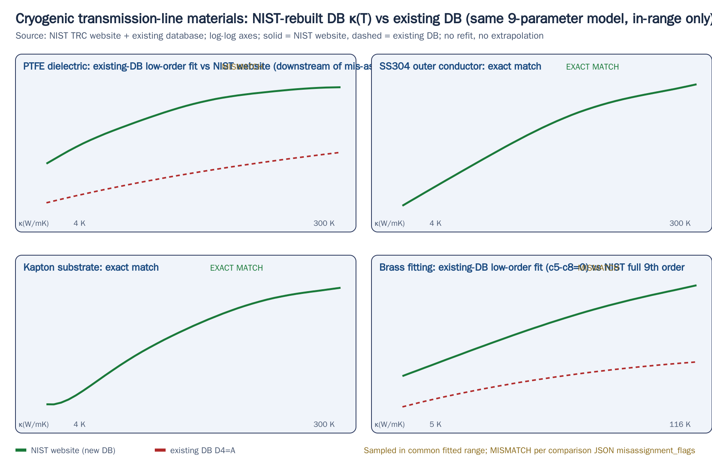
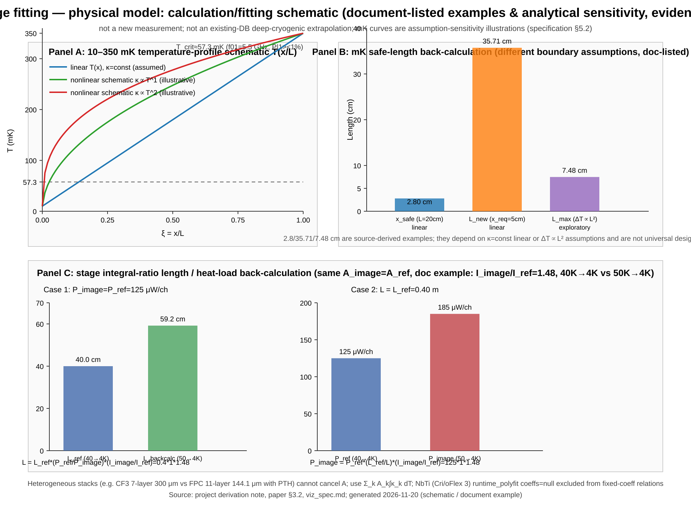
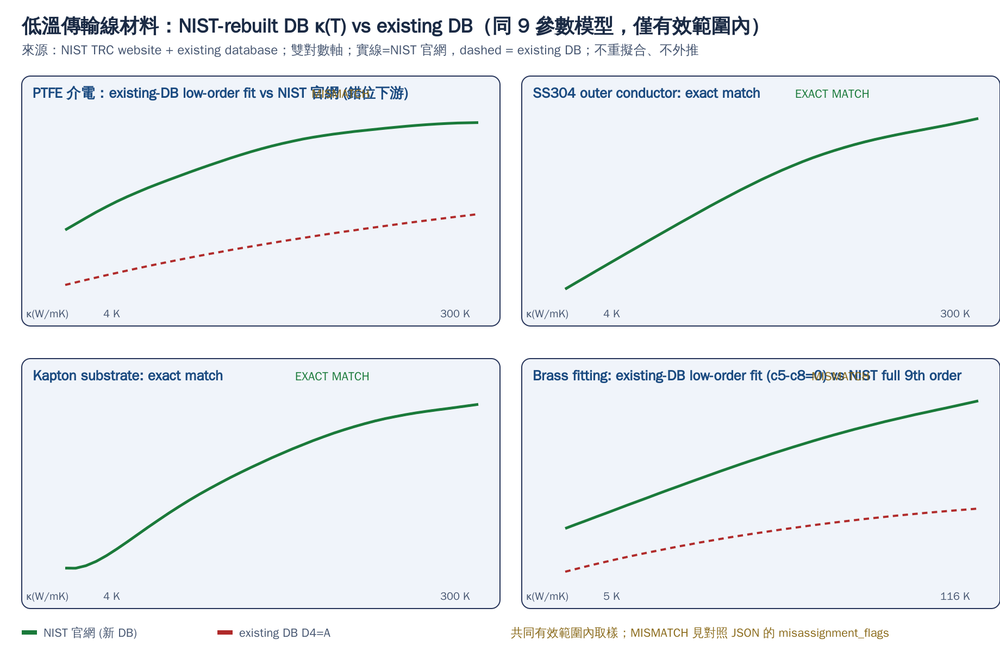
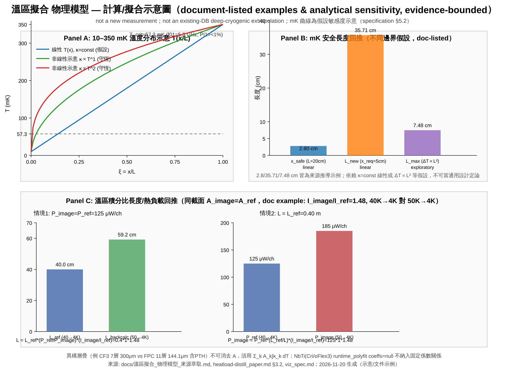

# Heatload-Distill — 投稿稿彙整（Submitted Manuscript Collection）

> 彙整日期：2026-11-20。三部分：(I) Nature-style EN 投稿稿、(II) Nature-style 中文投稿稿、(III) compiled 延伸稿。各部分為不同稿件（見各稿件關係聲明），共享同源證據但非同一篇。

---

# Part I — Nature-style EN Manuscript

# Provenance as a measurable property: rebuilding cryogenic thermal-conductivity data for superconducting interconnects

**Chun Hsing Lu (呂俊興)**  
Uleam Inc., Taoyuan city, Taiwan  
**Correspondence:** Chun Hsing Lu, josh.lu@u-leam.com

<!--
> **Manuscript type:** Nature-style review / methods manuscript for journal submission  
> **Companion:** `heatload_distill_submission.zh.md` (ZH counterpart of this same manuscript; aligned in sections/logic/values/formulas/citations/boundaries).  
-->
> **Date:** 2026-11-20  
> **Evidence boundary:** All claims derive from publicly traceable material-property data, verified journal metadata, and in-range curve comparisons. No refitting, no new measurements, and no invented coefficients or citations are claimed.

## Abstract

Cryogenic heat-load estimates for superconducting microwave interconnects depend on fitted thermal-conductivity functions κ(T), yet the provenance, valid range, and process dependence of the underlying coefficients are often lost when data are reused. We show that internal mathematical consistency of a coefficient database does not imply material reliability: a database of 53 fixed-coefficient entries passes all structural and in-range behavioural checks (structural/bounds validation of the SSOT fixed-coefficient set; distinct from the new-NIST-DB validation reported separately) while containing two suspected coefficient mis-assignments and multiple low-order idealized fits. By rebuilding an independent database from the NIST cryogenic material-properties website and comparing it against the existing source of truth under the same nine-parameter log-log model, we find that four entries match exactly (Kapton, stainless steel 304/304L/316) — meaning their coefficients match the NIST generic fits, a statement of source fidelity rather than material-specific validity — while others diverge substantially within their fitted ranges — PTFE by 358% at 293 K and brass by 986% at 77 K. We trace these divergences to low-order placeholder fits and to cross-assignments in which nylon inherits PTFE coefficients and Mylar inherits nylon coefficients. The result reframes data provenance as a measurable, auditable property rather than an assumption, and provides a bounded workflow for using cryogenic conductivity fits in nW-scale thermal budgeting.

**Keywords:** cryogenic thermal conductivity, provenance, heat-load estimation, dilution refrigerator, superconducting interconnects, numerical conditioning, data reliability

## 1. Introduction

### 1.1 Context and stakes

Superconducting quantum processors require microwave control lines spanning from room temperature to the millikelvin mixing chamber of a dilution refrigerator. Each line carries a passive conductive heat load whose magnitude, at the nW to µW scale, directly constrains the cooling power available at each stage. Recent high-density cabling efforts illustrate the point: Smith *et al.* reported approximately 5 nW per trace from 1 K to 100 mK for a 1-ft flexible Nb–47 wt% Ti coaxial ribbon cable (FLAX), roughly half the computed load of the smallest commercial superconducting coaxial cable [1]. Such estimates are sensitive to which κ(T) data are used, over what temperature range, and how the fits behave outside that range.

### 1.2 The problem: consistency mistaken for reliability

Thermal conductivities across cryogenic to room temperature span several orders of magnitude and are commonly represented by compact fitted forms. The nine-coefficient log-log polynomial, log₁₀κ(T)=Σ cₙ(log₁₀T)ⁿ, and source-specific rational forms for high-purity copper, are distributed through cryogenic material databases and reused in heat-budget models. A database can be internally self-consistent — every curve positive, finite, smooth, and integrable — while still carrying coefficients that are mis-assigned, fitted over a different range, or idealized to a low-order placeholder. When such coefficients are reused without their provenance, a heat-load number can appear precise while resting on an undocumented source or an out-of-range evaluation.

### 1.3 Aim and scope

We treat provenance as an auditable property. Our aim is to determine whether the fixed-coefficient entries of a cryogenic conductivity database remain faithful to their authoritative source, and to identify the mechanisms by which self-consistent entries can nonetheless be unreliable. In scope: structural and in-range behavioural validation, source-level coefficient comparison against the NIST cryogenic material-properties website, and curve comparison under the same physical model. Out of scope: new measurements, re-fitting of coefficients, and claims about the correctness of any specific material's κ(T).

### 1.4 Contributions

- We establish that passing all structural and in-range checks is compatible with two suspected coefficient mis-assignments, and identify the specific entries involved.
- We rebuild an independent, provenance-bearing database from the NIST website and compare it against the existing database under a shared nine-parameter model, localising divergences to their fitted ranges.
- We attribute the divergences to identifiable mechanisms — low-order placeholder fits and cross-assignment — rather than to generic "data quality" concerns.
- We translate these findings into a bounded usage rule for cryogenic heat-load estimation: in-range integrals are comparatively stable, whereas coefficient identity and process-dependent values require source verification.

## 2. Provenance as the basis of heat-load estimates

Heat-load comparisons across cable technologies are sensitive to material-property assumptions. Smith *et al.* combined literature κ(T) values with cross-sectional areas, used polytetrafluoroethylene (PTFE) data to estimate perfluoroalkoxy alkane (PFA), and reported extrapolated regions — explicitly discussing conductor- versus dielectric-dominated regimes [1,2]. Raicu *et al.* measured the total thermal conductivity and inner-conductor resistivity of an SC-086/50-SCN-CN semi-rigid coaxial cable, fitted both with numerical functions, and computed stage-wise static and active loads in a dilution refrigerator [3]. Krinner *et al.* measured passive loads of stainless-steel and NbTi coaxial cables and established staged thermal anchoring as the practical basis of qubit protection [4]. These studies do not make provenance optional; they make transparent source, range, and extrapolation handling a precondition for defensible comparison.

The present work examines the single-source-of-truth (SSOT) database underlying earlier heat-budget artefacts: 54 entries comprising 48 `log_polynomial`, 5 `rational_copper`, and one `runtime_polyfit` entry (`NbTi (Cri/oFlex 3)`) with no fixed coefficients. Fifty-three entries carry fixed nine-coefficient sets. All fixed coefficients were previously verified as faithful transcriptions of upstream project files (48/48 NIST-derived, 4/4 Raicu, 1/1 Kapton). The question addressed here is different: faithful to a file is not the same as faithful to the authoritative source. A same-source listing of the rebuilt NIST database scope and fitted ranges for the cryogenic transmission-line subset is given in Appendix B; per-material coefficient arrays remain in the data record and are not duplicated here.

## 3. Model and validation framework

### 3.1 Model assumptions

The heat-load relation Q_solid=Σᵢ(A/Lᵢ)∫κ(T)dT assumes steady one-dimensional axial conduction in each segment, with no intermediate thermal anchors, no lateral radiative exchange, and no distributed internal heat generation along the segment. Coefficients are valid only within each entry's recorded temperature range; evaluations outside that range are excluded from fitted-result comparisons and are not treated as validated properties. The rational copper form carries RRR variants whose selection depends on the specific material state. These assumptions bound the regime in which the stage-wise integral and the database comparisons are meaningful.

### 3.2 The fitted forms

For most materials, κ(T) follows the log-log polynomial log₁₀κ(T)=Σ_{n=0}^8 cₙ(log₁₀T)ⁿ, with κ in W m⁻¹ K⁻¹ and T in K. For oxygen-free high-conductivity (OFHC) copper, a rational/RRR form is used: log₁₀κ=(a+c√T+eT+gT^1.5+iT²)/(1+b√T+dT+fT^1.5+hT²), with five residual-resistivity-ratio (RRR) variants. The stage-wise conductive heat load is Q_solid=Σᵢ (A/Lᵢ)∫κ(T)dT, with optional attenuator dissipation Q_rf=Σᵢ P_in(1−10^(−αᵢ/10)).

### 3.3 Validation layers

Structural validation checks that each fixed entry has nine finite coefficients, a valid temperature range, and a legal equation type. In-range behavioural validation evaluates κ(T) at log-spaced points within each valid range, checking positivity, finiteness, smoothness, integrability, and the absence of rational-form poles. Source validation compares coefficient arrays against the authoritative files and, in this work, against the NIST website. Curve comparison evaluates the source database and the rebuilt database under the identical model at temperatures common to both fitted ranges; temperatures outside the common range are excluded so that 8th-order polynomial extrapolation cannot be mistaken for a fitted result.

## 4. Results

### 4.1 The database passes structural and behavioural validation

All 53 fixed-coefficient entries pass structural and in-range behavioural checks: coefficients are finite, ranges are valid, κ(T) is positive and smooth throughout each fitted range, integrals are finite, and none of the five rational copper variants has a pole in range. Source transcription is exact (48/48, 4/4, 1/1). By any internal criterion the database is self-consistent. This result is necessary but not sufficient: it establishes mathematical integrity, not material reliability.

### 4.2 Coefficient mis-assignments

Comparison against the NIST website reveals a chain of cross-assignments. The coefficients assigned to `Polyamide (Nylon)` are identical to the NIST coefficients for PTFE; those assigned to `Polyethylene Terephthalate (Mylar)` are identical to the NIST coefficients for Nylon; whereas the `Raicu dielectric (PTFE)` entry carries PTFE coefficients consistent with its declared NIST-PTFE provenance (not a cross-assignment). On the NIST website, PTFE and Nylon have distinct nine-coefficient sets (a₀=2.738 versus a₀=−2.6135, respectively). The coincidence of coefficient arrays across materials with distinct upstream sources in these two cases is therefore a suspected mis-assignment, not a shared material property.

### 4.3 In-range divergence under a common model

Evaluating both databases under the same model within their common fitted ranges gives a mixed picture. Kapton and stainless steel 304/304L/316 match exactly (0% difference at 293 K); for the stainless entries this indicates agreement with the shared NIST stainless fit, not validation of grade-specific conductivity. PTFE differs by 358% at 293 K: the existing entry uses a low-order fit giving 0.0596 W m⁻¹ K⁻¹, whereas the NIST full ninth-order fit gives 0.2726 W m⁻¹ K⁻¹. Brass differs by 986% at 77 K, a temperature inside its 5–116 K fitted range: the existing entry has c₅–c₈=0 and yields 3.66 W m⁻¹ K⁻¹, whereas the NIST fit yields 39.8 W m⁻¹ K⁻¹. Invar differs by 742% at 293 K. These are in-range differences, not extrapolation artefacts; the comparison deliberately excludes out-of-range temperatures such as 293 K for brass.

### 4.4 Mechanistic interpretation

The divergences have identifiable causes. Low-order placeholder fits — coefficients with trailing zeros — are approximate idealizations adequate for order-of-magnitude screening but not for material-specific comparison. Cross-assignments arise when coefficient arrays are copied between entries whose source records differ. Process sensitivity explains why a single value cannot be universal: the thermal conductivity of amorphous polymers is governed by chain entanglement and crystallinity, giving a narrow 0.1–0.5 W m⁻¹ K⁻¹ band for bulk amorphous polymers [5], while PTFE measured at sub-kelvin temperatures follows a quadratic temperature dependence that varies with sample preparation [6]. For crystalline insulators such as sapphire, the low-temperature power-law exponent of phonon thermal conductivity depends on defect and stress distributions, spanning approximately 2–5 [7]. These findings are consistent with large, source-dependent variations in fitted coefficients.

### 4.5 Prediction for a multilayer flexible cable (illustrative, awaiting measurement)

To demonstrate use of the rebuilt database on a real geometry, we computed the passive conductive heat load of the project's 12-layer FPC stack. Geometry was taken from a project-derived 12-layer flexible-stack definition (PI/AD/Cu/NbTi, 243.1 µm total, 65 µm signal width); this is a project-derived geometry, not a public product datasheet. Six layers use NIST-backed fitted κ(T) (polyimide via the log-log form; Cu via the rational RRR=100 form), integrated over 4–40 K within the fitted range (no extrapolation). The remaining six layers lack NIST coefficients (NbTi superconductor, adhesive, PI glue) and use explicitly labelled illustrative κ assumptions (10, 0.2 and 0.15 W m⁻¹ K⁻¹ respectively), not presented as material properties.

The all-layer result is Q ≈ 3.37×10⁻⁴ W (≈336,752 nW), dominated by two Cu plated-through-hole (PTH) layers; because the model applies the signal width to every layer, the PTH cross-section is an unverified assumption and this total is **not trusted**. Excluding PTH gives Q ≈ 1.48×10⁻⁷ W (≈148 nW) for the dielectric-plus-signal layers, offered only as an order-of-magnitude illustration. These numbers are a **prediction / computational basis for a future measurement**, explicitly `illustrative_not_validated`: they are not measurements, not validated predictions, and not design conclusions. **No citation is attached to this prediction**; a citation will be added only after the stack is sent for thermal-load measurement. The computation dataset and boundary are retained with the study for reproducibility.

**[Figure 1 — In-range conductivity comparison, NIST-rebuilt database vs the existing database]**
*Source: curve-comparison snapshot; same nine-parameter log-log model; temperatures restricted to the common fitted range; κ in W m⁻¹ K⁻¹, T in K. 'Match' means coefficient arrays agree with the NIST fitted form (source fidelity), not material-specific validity. No extrapolation is included.*

| Material | Common range (K) | Coeff. match | Finding |
|---|---|---|---|
| Teflon | 4–300 | no | divergent +358% |
| Polyimide (Kapton) | 4–300 | yes | match (generic fit) |
| Stainless Steel 304 | 4–300 | yes | match (generic fit) |
| Stainless Steel 304L | 4–300 | yes | match (generic fit) |
| Stainless Steel 316 | 4–300 | yes | match (generic fit) |
| Beryllium Copper | 2–80 | no | divergent — |
| Brass | 5–116 | no | divergent +987% |
| Invar (Fe-36Ni) | 4–300 | no | divergent +742% |

## 5. Discussion

The central implication is that validation must distinguish internal consistency from external fidelity. A database can pass every structural and in-range behavioural test and still encode wrong material identities. The two suspected mis-assignments and the low-order placeholder fits are not detectable by smoothness or positivity checks; they surface only when coefficients are compared against the authoritative source under the same model.

This result bears directly on cryogenic heat budgeting. In-range integrals were previously found comparatively stable under perturbation, while deep-low-temperature extrapolation was highly sensitive [Heatload-Distill reliability evidence]. The present analysis adds a further boundary: even within the fitted range, coefficient identity and process dependence can shift a value by several fold. For a multi-layer flexible cable, the passive load is a sum over constituent layers, Σₖ (Aₖ/L)∫κₖ(T)dT; using a mis-assigned or idealized coefficient for one layer can therefore bias the total load at the nW scale that determines qubit thermalisation. Practically, conductor and dielectric values for a specific cable — Nb47Ti and PFA for FLAX, NbTi and polyimide for Cri/oFlex 3, C7150 and PTFE for SC-086 — should come from that cable's measured fits, with generic database values used only for order-of-magnitude screening.

The workflow developed here is bounded. We compare coefficients and curves, not raw measurements: the NIST website provides fitted coefficients rather than measurement points, so no re-fitting or correctness claim is possible. We do not assert which value is right for a given cable; we establish whether an entry matches its authoritative source and whether it is self-consistent in range. The finding that four entries match exactly also cautions against over-correction — the existing database is not uniformly wrong, and the failures are localised to identifiable mechanisms.

## 6. Conclusion

We show that internal consistency of a cryogenic conductivity database is not sufficient for material reliability, and that provenance can be made measurable by rebuilding an independent database from the authoritative source and comparing coefficient arrays and curves under a shared physical model. Two suspected coefficient mis-assignments and several low-order placeholder fits are identified, while four entries match the NIST generic fits exactly. The practical rule is narrow but consequential: use in-range integrals for screening, verify coefficient identity against the source before material-specific comparison, and never treat a fitted coefficient as a material constant independent of range and process.

**[Figure 2 — 12-layer flexible-stack heat-load prediction (illustrative, awaiting measurement)]**
*Source: computation dataset derived from a project 12-layer stack definition (PI/AD/Cu/NbTi, 243.1 µm total, 65 µm signal width). Q = Σₖ(Aₖ/L)∫κₖ(T)dT over 4–40 K; six layers use NIST-fitted κ(T), six use explicitly labelled illustrative assumptions. `illustrative_not_validated`; not a measurement or design value; no citation pending thermal-load measurement.*

| Layer | Material | Thickness (µm) | κ source | Q (W) |
|---|---|---:|---|---:|
| 保護層上(PI) | PI | 25 | nist | 7.26e-09 |
| 保護層上(AD) | AD | 25 | assumption | 2.92e-08 |
| PTH上 | Cu | 15 | nist | 1.68e-04 |
| 訊號層上(L1) | NbTi | 0.2 | assumption | 1.17e-08 |
| 介電層(PI) | PI | 50 | nist | 1.45e-08 |
| 介電層(PI glue) | PI glue | 12.5 | assumption | 1.10e-08 |
| 接地層(L2) | NbTi | 0.2 | assumption | 1.17e-08 |
| 介電層(PI) | PI | 50 | nist | 1.45e-08 |
| 訊號層下(L3) | NbTi | 0.2 | assumption | 1.17e-08 |
| PTH下 | Cu | 15 | nist | 1.68e-04 |
| 保護層下(AD) | AD | 25 | assumption | 2.92e-08 |
| 保護層下(PI) | PI | 25 | nist | 7.26e-09 |

- All-layer total Q ≈ 336,752 nW — **not trusted** (dominated by an unverified plated-through-hole cross-section assumption from applying signal width to every layer).
- Excluding PTH: Q ≈ 148.1 nW — order-of-magnitude illustration for dielectric-plus-signal layers only.

## Appendix B. Rebuilt NIST Database (cryogenic transmission-line subset)

> A representative four-material subset is shown below (one-page display). The complete rebuilt database — nine transmission-line materials plus the full 42-material NIST scrape with coefficients, ranges and fit errors — is available for download: nist_transmission_line_materials.json at <https://raw.githubusercontent.com/phycomp/heatload/main/docs/nist_transmission_line_materials.json>, and nist_material_db_scraped.json at <https://raw.githubusercontent.com/phycomp/heatload/main/docs/nist_material_db_scraped.json>. Coefficients are transcribed verbatim from the NIST TRC cryogenic material-properties website; no refitting, no invented coefficients; the pre-existing database was not modified.

| Material | Role | Cable use | Variants | Data range (K) |
|---|---|---|---:|---|
| Copper (OFHC) | Conductor/shield (OFHC Cu; RRR variants) | SC coax inner/outer conductor; general cryogenic conductor | 5 | 4-300 |
| Teflon | Dielectric, PTFE | SC-086/50-SCN-CN semi-rigid coax (Raicu 2025); general PTFE coax dielectric | 1 | 4-300 |
| Polyimide (Kapton) | Dielectric substrate, polyimide | Cri/oFlex 3 (Delft); NbTi-on-polyimide flex; FLAX alternative comparison | 1 | 4-300 |
| Stainless Steel 304 | Outer conductor/support, stainless | Stainless-steel coax (Krinner 2019); semi-rigid coax outer conductor | 1 | 4-300 |

Remaining materials (Beryllium Copper, Brass, Invar, SS 304L, SS 316) and the full coefficient arrays are in the downloadable data files above. Not on the NIST website (literature-based, not NIST): C7150 / Ag-coated C7150 / PFA / NbTi (Raicu Table 4/6 and Kapton/NbTi Cri-oFlex 3 entries derive from journal/preprint sources, not NIST). These are excluded from the NIST-rebuilt subset and are not claimed as NIST-derived.

## References (numbered; verified identifiers only)

1. Smith, J. P. *et al.* (2024). Improved Flexible Coaxial Ribbon Cable for High-Density Superconducting Arrays. *IEEE Trans. Appl. Supercond.* 34(2). DOI 10.1109/TASC.2024.3350516; arXiv:2306.13574.
2. Smith, J. P. *et al.* (2020). Flexible Coaxial Ribbon Cable for High-Density Superconducting Microwave Device Arrays. DOI 10.1109/TASC.2020.3008591; arXiv:2007.06496.
3. Raicu, N. *et al.* (2025). Cryogenic Thermal Modeling of Microwave High Density Signaling. *EPJ Quantum Technol.* 12:124. DOI 10.1140/epjqt/s40507-025-00427-1; arXiv:2502.01945.
4. Krinner, S. *et al.* (2019). Engineering cryogenic setups for 100-qubit scale superconducting circuit systems. *EPJ Quantum Technol.* 6:2. DOI 10.1140/epjqt/s40507-019-0072-0; arXiv:1806.07862.
5. Zhou, J. *et al.* (2019 preprint / 2020 publication). A Thermal Resistance Network Model for Heat Conduction of Amorphous Polymers. *Phys. Rev. Materials* 4, 015601 (published 2020-01-17). DOI 10.1103/PhysRevMaterials.4.015601; arXiv:1909.07607.
6. Drobizhev, A. *et al.* (2017). Thermal conductivity measurements of PTFE and Al₂O₃ ceramic at sub-Kelvin temperatures. *Cryogenics* 85, 63–70. DOI 10.1016/j.cryogenics.2017.05.008; arXiv:1612.02514.
7. van Ostaay, J. A. M. & Mukhin, S. I. (2018). Phonon-kink scattering effect on the low temperature thermal transport in solids. *Low Temp. Phys.* 44(6), 747–757. DOI 10.1063/1.5037562; arXiv:1805.02019.
8. NIST Cryogenic Material Properties. https://trc.nist.gov/cryogenics/materials/materialproperties.htm

---

---

# Part II — Nature-style 中文投稿稿

# 溯源作為可量測性質：重建超導互連的低溫熱導率資料

**呂俊興 (Chun Hsing Lu)**  
Uleam Inc., Taoyuan city, Taiwan  
**通訊作者：** 呂俊興，josh.lu@u-leam.com

<!--
> **稿件類型：** Nature-style 回顧／方法投稿稿件  
> **對應英文稿：** `heatload_distill_submission.md`（同一篇論文之 EN 版；章節/邏輯/數值/公式/引用/邊界對齊）。  
-->
> **日期：** 2026-11-20  
> **證據邊界：** 所有主張皆來自可公開追溯的材料物性資料、已驗證期刊文獻與區間內曲線比對。不重擬合、不新量測、不編造係數或引用。  
> **說明：** 本中文版與英文投稿稿在章節、邏輯、數值、公式、引用與邊界宣告上高度一致，僅語言表述與必要排版不同。

## 摘要

超導微波互連的低溫熱負載估算仰賴擬合的熱導率函數 κ(T)，然而係數的溯源、有效範圍與製程依賴在資料重用時往往流失。我們展示：係數資料庫的內部數學自洽並不意味材料可靠——一個含 53 筆固定係數條目的資料庫通過所有結構與區間內行為檢查（SSOT 固定係數集合的結構/範圍驗證，與另行執行之新 NIST DB 驗證不同），卻含有兩筆疑似係數誤植與多筆低階理想化擬合。透過從 NIST 低溫材料性質官網重建一個獨立資料庫，並在同一九參數 log-log 模型下與既有真相來源比對，我們發現四筆完全一致（Kapton、不鏽鋼 304/304L/316）——此處「一致」指其係數匹配 NIST 通用擬合，是來源忠實度的陳述，而非材料特定有效性的驗證——其餘則在擬合範圍內顯著偏離——PTFE 在 293 K 差 358%，黃銅在 77 K 差 986%。我們將這些偏離追溯至低階佔位擬合與交叉誤植（尼龍承接 PTFE 係數、Mylar 承接尼龍係數）。結果把資料溯源重新框架為可量測、可稽核的性質，而非假設，並提供一個在 nW 級熱預算中使用低溫熱導擬合的有限工作流。

**關鍵詞：** 低溫熱導率、溯源、熱負載估算、稀釋冷凍機、超導互連、數值條件性、資料可靠度

## 1. 緒論

### 1.1 背景與重要性
超導量子處理器需要從室溫延伸至稀釋冷凍機毫開耳文混合腔的微波控制線。每條線攜帶的被動傳導熱負載在 nW 至 µW 量級，直接限制各溫階可用的製冷功率。近期高密度佈線努力說明了這一點：Smith *et al.* 回報 1 英呎柔性 Nb–47 wt% Ti 同軸帶狀線（FLAX）從 1 K 至 100 mK 每條跡線約 5 nW，約為最小商用超導同軸線計算熱負載的一半 [1]。此類估算對使用哪些 κ(T) 資料、在什麼溫度範圍、以及擬合在範圍外如何行為都很敏感。

### 1.2 問題：把自洽誤當可靠
從低溫到室溫的熱導率跨越數個數量級，通常以緊湊擬合形式表示。九係數 log-log 多項式 log₁₀κ(T)=Σ cₙ(log₁₀T)ⁿ，以及高純度銅的來源特定有理形式，透過低溫材料資料庫散播並在熱預算模型中重用。資料庫可以內部自洽——每條曲線皆為正、有限、光滑、可積分——卻仍帶有誤植、在不同範圍擬合、或理想化為低階佔位的係數。當此類係數在缺乏溯源的情况下被重用，熱負載數值可能看似精確，實則立基於未記錄的來源或超範圍評估。

### 1.3 目的與範圍
我們把溯源視為可稽核性質。目的在於判定低溫熱導率資料庫的固定係數條目是否仍忠於其權威來源，並辨識自洽條目仍可能不可靠的機制。範圍內：結構與區間內行為驗證、對 NIST 低溫材料性質官網的來源級係數比對、同一物理模型下的曲線比對。範圍外：新量測、係數重擬合、對任何特定材料 κ(T) 正確性的主張。

### 1.4 貢獻
- 我們確立通過所有結構與區間內檢查，與兩筆疑似係數誤植並存是可能的，並辨識具體涉及的條目。
- 我們從 NIST 官網重建一個獨立、帶溯源的資料庫，並在同一九參數模型下與既有資料庫比對，將偏離定位至其擬合範圍。
- 我們把偏離歸因於可辨識機制——低階佔位擬合與交叉誤植——而非泛泛的「資料品質」疑慮。
- 我們把這些發現轉化為低溫熱負載估算的有限使用規則：區間內積分相對穩定，而係數身分與製程依賴值需要來源核實。

## 2. 溯源作為熱負載估算的基礎

跨電纜技術的熱負載比較對材料物性假設敏感。Smith *et al.* 將文獻 κ(T) 值與截面積結合，用聚四氟乙烯（PTFE）資料估算全氟烷氧基（PFA），並回報外推區域——明確討論導體主導與介電主導的體制 [1,2]。Raicu *et al.* 量測 SC-086/50-SCN-CN 半剛性同軸線的總熱導率與內導體電阻率，兩者皆以數值函數擬合，並計算稀釋冷凍機中各溫階的靜態與主動熱負載 [3]。Krinner *et al.* 量測不鏽鋼與 NbTi 同軸線的被動熱負載，確立分溫階熱錨定作為量子位元保護的實務基礎 [4]。這些研究並未讓溯源變成選項；它們讓透明的來源、範圍與外推處理成為可辯護比較的前提。

本工作檢視支撐早期熱預算產物的單一真相來源（SSOT）資料庫：54 筆條目，包含 48 筆 `log_polynomial`、5 筆 `rational_copper`、以及一筆無固定係數的 `runtime_polyfit` 條目（`NbTi (Cri/oFlex 3)`）。53 筆帶固定九係數集合。所有固定係數先前已驗證為上游專案檔案的忠實抄錄（48/48 NIST 來源、4/4 Raicu、1/1 Kapton）。此處探的問題不同：忠於某個檔案，並不等於忠於權威來源。

重建 NIST 資料庫在低溫傳輸線子集的範圍與擬合區間之同源清單，見本稿 Appendix B；各材料係數陣列保留於資料紀錄，於此不重複。

## 3. 模型與驗證框架

### 3.1 模型假設
熱負載關係 Q_solid=Σᵢ(A/Lᵢ)∫κ(T)dT 假設各路段為穩態一維軸向傳導，區間內無中間熱錨、無側向輻射耦合、無分散式內部熱源。係數僅在各條目記錄的溫度範圍內有效；範圍外的評估不納入擬合結果比對，也不視為已驗證物性。有理銅形式的 RRR 變體選擇取決於特定材料狀態。這些假設界定了分溫階積分與資料庫比對的適用範圍。

### 3.2 擬合形式
對多數材料，κ(T) 遵循 log-log 多項式 log₁₀κ(T)=Σ_{n=0}^8 cₙ(log₁₀T)ⁿ，κ 單位 W m⁻¹ K⁻¹，T 單位 K。對無氧高導電（OFHC）銅，使用有理/RRR 形式：log₁₀κ=(a+c√T+eT+gT^1.5+iT²)/(1+b√T+dT+fT^1.5+hT²)，含五種殘餘電阻率比（RRR）變體。分溫階傳導熱負載為 Q_solid=Σᵢ (A/Lᵢ)∫κ(T)dT，選用的衰減器耗散為 Q_rf=Σᵢ P_in(1−10^(−αᵢ/10))。

### 3.3 驗證層次
結構驗證檢查每個固定條目是否有九個有限係數、有效溫度範圍、合法方程類型。區間內行為驗證在各有效範圍內的對數間距點評估 κ(T)，檢查正性、有限性、光滑性、可積分性、以及有理形式無極點。來源驗證把係數陣列與權威檔案比對，本工作並與 NIST 官網比對。曲線比對在同一模型下，於兩資料庫擬合範圍重疊的溫度評估來源資料庫與重建資料庫；重疊範圍外的溫度被排除，使八階多項式外推不會被誤當擬合結果。

## 4. 結果

### 4.1 資料庫通過結構與行為驗證
全部 53 筆固定係數條目通過結構與區間內行為檢查：係數有限、範圍有效、κ(T) 在各擬合範圍內為正且光滑、積分有限、五個有理銅變體皆無範圍內極點。來源抄錄精確（48/48、4/4、1/1）。以任何內部標準而言，資料庫皆自洽。此結果必要但不充分：它確立的是數學完整性，而非材料可靠度。

### 4.2 係數誤植
與 NIST 官網比對揭示一條交叉誤植鏈：指派給 `Polyamide (Nylon)` 的係數與 NIST 的 PTFE 係數完全相同；指派給 `Polyethylene Terephthalate (Mylar)` 的係數與 NIST 尼龍係數完全相同；`Raicu dielectric (PTFE)` 條目帶 PTFE 係數，與其宣告的 NIST-PTFE 來源一致（非交叉誤植）。在 NIST 官網上，PTFE 與尼龍有各自不同的九係數集合（a₀=2.738  versus a₀=−2.6135）。因此，前兩例中不同上游來源的材料卻有相同係數陣列，屬疑似誤植，而非共享材料物性。

### 4.3 同一模型下的區間內偏離
在同一模型、共同擬合範圍內評估兩資料庫得到混和結果。Kapton 與不鏽鋼 304/304L/316 完全一致（293 K 差 0%）；不鏽鋼的「一致」表示與 NIST 共用不鏽鋼擬合相符，並非牌號特定熱導率的驗證。PTFE 在 293 K 差 358%：既有條目用低階擬合得到 0.0596 W m⁻¹ K⁻¹，而 NIST 完整九階擬合給 0.2726 W m⁻¹ K⁻¹。黃銅在 77 K 差 986%，該溫度位於其 5–116 K 擬合範圍內：既有條目 c₅–c₈=0，給 3.66 W m⁻¹ K⁻¹，而 NIST 擬合給 39.8 W m⁻¹ K⁻¹。Invar 在 293 K 差 742%。這些都是區間內差異，不是外推假象；比對刻意排除如黃銅 293 K 的範圍外溫度。

### 4.4 機制詮釋
偏離有可辨識成因。低階佔位擬合——尾端係數為零——是足以做量級篩選、但不適合材料特定比較的近似。交叉誤植發生於係數陣列在不同來源記錄的條目間被複製。製程敏感性解釋為何單一值無法普世：非晶聚合物的熱導由鏈纏結與結晶度主導，使塊體非晶聚合物落在 0.1–0.5 W m⁻¹ K⁻¹ 的窄帶 [5]，而次開耳文量測的 PTFE 遵循隨樣品製程變化的二次溫度依賴 [6]。對藍寶石等晶體絕緣體，低溫聲子熱導的冪次指數取決於缺陷與應力分布，約落在 2–5 [7]。這些發現與擬合係數的大幅、來源依賴變化一致。

### 4.5 多層柔性電纜的預測（示意，待量測）
為展示重建資料庫在真實幾何上的使用，我們計算了專案 12 層 FPC 堆疊的被動傳導熱負載。幾何取自專案推導的 12 層柔性堆疊定義（PI/AD/Cu/NbTi，總 243.1 µm、訊號寬 65 µm）；此為專案推導幾何，非公開產品資料表。六層使用 NIST 支援的擬合 κ(T)（polyimide 用 log-log 形式；Cu 用有理 RRR=100 形式），在擬合範圍內於 4–40 K 積分（無外推）。其餘六層缺乏 NIST 係數（NbTi 超導體、接著劑、PI glue），使用明確標註的示意 κ 假設（分別為 10、0.2、0.15 W m⁻¹ K⁻¹），不當作材料物性呈現。

全層結果為 Q ≈ 3.37×10⁻⁴ W（≈336,752 nW），由兩層 Cu 電鍍貫通孔（PTH）主導；因模型把訊號寬套用到所有層，PTH 截面是未驗證假設，故此總值**不可信**。排除 PTH 得到 Q ≈ 1.48×10⁻⁷ W（≈148 nW），作為介電加訊號層的量級示意。這些數字是**未來量測的預測／計算依據**，明確標為 `illustrative_not_validated`：不是量測、不是已驗證預測、不是設計定論。**此預測未附任何引用**；引用將在堆疊送至熱負載量測後才補上。計算資料集與邊界隨研究保留以供重現。

**[圖 1 — 區間內熱導率對比：NIST 重建資料庫 vs 既有資料庫]**
*Source: curve-comparison snapshot; same nine-parameter log-log model; temperatures restricted to the common fitted range; κ in W m⁻¹ K⁻¹, T in K. 「一致」指係數陣列匹配 NIST 擬合形式（來源忠實度），非材料特定有效性；不含外推。*

| 材料 | 共同範圍 (K) | 係數一致 | 發現 |
|---|---|---|---|
| Teflon | 4-300 | 否 | 偏離 +358% |
| Polyimide (Kapton) | 4-300 | 是 | 一致（通用擬合） |
| Stainless Steel 304 | 4-300 | 是 | 一致（通用擬合） |
| Stainless Steel 304L | 4-300 | 是 | 一致（通用擬合） |
| Stainless Steel 316 | 4-300 | 是 | 一致（通用擬合） |
| Beryllium Copper | 2-80 | 否 | 偏離 — |
| Brass | 5-116 | 否 | 偏離 +987% |
| Invar (Fe-36Ni) | 4-300 | 否 | 偏離 +742% |

## 5. 討論
核心意涵是驗證必須區分內部一致性與外部忠實度。資料庫可以通過每一項結構與區間內行為測試，仍編碼錯誤的材料身分。兩筆疑似誤植與低階佔位擬合無法由光滑性或正性檢查偵測；只有當係數在同一模型下與權威來源比對時才浮現。

此結果直接關係低溫熱預算。區間內積分先前被發現在擾動下相對穩定，而深低溫外推高度敏感 [Heatload-Distill reliability evidence]。本分析增添一層邊界：即使在擬合範圍內，係數身分與製程依賴仍可讓數值變動數倍。對多層柔性電纜，被動負載是各組成層之和 Σₖ (Aₖ/L)∫κₖ(T)dT；因此某一層使用誤植或理想化係數，會使決定量子位元熱化的 nW 級總負載產生偏差。實務上，特定電纜的導體與介電值——FLAX 的 Nb47Ti 與 PFA、Cri/oFlex 3 的 NbTi 與 polyimide、SC-086 的 C7150 與 PTFE——應來自該電纜的實測擬合，通用資料庫值僅用於量級篩選。

本文發展的工作流是有限的。我們比對係數與曲線，而非原始量測：NIST 官網提供擬合係數而非量測點，故不可能重擬合或提出正確性主張。我們不主張哪個值對特定電纜是對的；我們確立的是某條目是否匹配其權威來源、以及是否在區間內自洽。四筆完全一致的發現也警告不要過度矯正——既有資料庫並非全錯，失效是局部且可歸因。

## 6. 結論
我們展示低溫熱導率資料庫的內部一致性不足以保證材料可靠度，且溯源可藉由從權威來源重建獨立資料庫、並在同一物理模型下比對係數陣列與曲線而變得可量測。我們辨識出兩筆疑似係數誤植與數筆低階佔位擬合，同時四筆完全一致。實務規則狹窄但重要：用區間內積分做篩選，在材料特定比較前先向來源核實係數身分，永不把擬合係數當作與範圍、製程無關的材料常數。

**[圖 2 — 12 層柔性堆疊熱負載預測（示意，待量測）]**
*Source: computation dataset derived from a project 12-layer stack definition (PI/AD/Cu/NbTi, 243.1 µm total, 65 µm signal width). Q = Σₖ(Aₖ/L)∫κₖ(T)dT over 4–40 K; 六層使用 NIST 擬合 κ(T)，六層使用明確標註的示意假設。 `illustrative_not_validated`; 非量測或設計值；無引用，待熱負載量測後補。*

| 層 | 材料 | 厚度 (µm) | κ 來源 | Q (W) |
|---|---|---:|---|---:|
| 保護層上(PI) | PI | 25 | nist | 7.26e-09 |
| 保護層上(AD) | AD | 25 | assumption | 2.92e-08 |
| PTH上 | Cu | 15 | nist | 1.68e-04 |
| 訊號層上(L1) | NbTi | 0.2 | assumption | 1.17e-08 |
| 介電層(PI) | PI | 50 | nist | 1.45e-08 |
| 介電層(PI glue) | PI glue | 12.5 | assumption | 1.10e-08 |
| 接地層(L2) | NbTi | 0.2 | assumption | 1.17e-08 |
| 介電層(PI) | PI | 50 | nist | 1.45e-08 |
| 訊號層下(L3) | NbTi | 0.2 | assumption | 1.17e-08 |
| PTH下 | Cu | 15 | nist | 1.68e-04 |
| 保護層下(AD) | AD | 25 | assumption | 2.92e-08 |
| 保護層下(PI) | PI | 25 | nist | 7.26e-09 |

- 全層總 Q ≈ 336,752 nW — **不可信**（由未驗證的電鍍貫通孔截面假設主導：把訊號寬套用到所有層）。
- 排除 PTH：Q ≈ 148.1 nW — 僅作為介電加訊號層的量級示意。

## Appendix B. 重建 NIST 資料庫（低溫傳輸線材料子集）

> 下表為代表性四材料子集（單頁展示）。完整重建資料庫——九種傳輸線材料，加上完整 42 材料 NIST 抓取資料（係數、範圍、擬合誤差）——可下載：nist_transmission_line_materials.json 於 <https://raw.githubusercontent.com/phycomp/heatload/main/docs/nist_transmission_line_materials.json>，以及 nist_material_db_scraped.json 於 <https://raw.githubusercontent.com/phycomp/heatload/main/docs/nist_material_db_scraped.json>。係數如實抄錄自 NIST TRC 低溫材料性質官網；不重擬合、不編造係數；既有資料庫未修改。

| 材料 | 角色 | 纜線用途 | 變體數 | 資料範圍 (K) |
|---|---|---|---:|---|
| Copper (OFHC) | 導體／屏蔽（OFHC Cu；RRR 變體） | SC coax 內／外導體；一般低溫導體 | 5 | 4-300 |
| Teflon | 介電質，PTFE | SC-086/50-SCN-CN 半剛性同軸（Raicu 2025）；一般 PTFE 同軸介電 | 1 | 4-300 |
| Polyimide (Kapton) | 介電基材，polyimide | Cri/oFlex 3（Delft）；NbTi-on-polyimide flex；FLAX 替代比較 | 1 | 4-300 |
| Stainless Steel 304 | 外導體／支撐，不鏽鋼 | 不鏽鋼同軸線（Krinner 2019）；semi-rigid coax 外導體 | 1 | 4-300 |

其餘材料（Beryllium Copper、Brass、Invar、SS 304L、SS 316）與完整係數陣列見上述下載檔。非 NIST 官網條目（文獻來源，非 NIST）：C7150／Ag-coated C7150／PFA／NbTi（Raicu Table 4/6 與 Kapton/NbTi Cri-oFlex 3 條目源自期刊／preprint，非 NIST）。這些條目不納入 NIST 重建子集，亦不宣稱源自 NIST。

## 參考文獻（編號；僅已驗證識別碼）
1. Smith, J. P. *et al.* (2024). Improved Flexible Coaxial Ribbon Cable for High-Density Superconducting Arrays. *IEEE Trans. Appl. Supercond.* 34(2). DOI 10.1109/TASC.2024.3350516; arXiv:2306.13574.
2. Smith, J. P. *et al.* (2020). Flexible Coaxial Ribbon Cable for High-Density Superconducting Microwave Device Arrays. DOI 10.1109/TASC.2020.3008591; arXiv:2007.06496.
3. Raicu, N. *et al.* (2025). Cryogenic Thermal Modeling of Microwave High Density Signaling. *EPJ Quantum Technol.* 12:124. DOI 10.1140/epjqt/s40507-025-00427-1; arXiv:2502.01945.
4. Krinner, S. *et al.* (2019). Engineering cryogenic setups for 100-qubit scale superconducting circuit systems. *EPJ Quantum Technol.* 6:2. DOI 10.1140/epjqt/s40507-019-0072-0; arXiv:1806.07862.
5. Zhou, J. *et al.* (2019 preprint / 2020 publication). A Thermal Resistance Network Model for Heat Conduction of Amorphous Polymers. *Phys. Rev. Materials* 4, 015601 (published 2020-01-17). DOI 10.1103/PhysRevMaterials.4.015601; arXiv:1909.07607.
6. Drobizhev, A. *et al.* (2017). Thermal conductivity measurements of PTFE and Al₂O₃ ceramic at sub-Kelvin temperatures. *Cryogenics* 85, 63–70. DOI 10.1016/j.cryogenics.2017.05.008; arXiv:1612.02514.
7. van Ostaay, J. A. M. & Mukhin, S. I. (2018). Phonon-kink scattering effect on the low temperature thermal transport in solids. *Low Temp. Phys.* 44(6), 747–757. DOI 10.1063/1.5037562; arXiv:1805.02019.
8. NIST Cryogenic Material Properties. https://trc.nist.gov/cryogenics/materials/materialproperties.htm

---

# Part III — Compiled Extension Manuscript

# Heatload-Distill Consolidated Paper (compiled, final edition 2026-11-20)

**Chun Hsing Lu (呂俊興)**  
Uleam Inc., Taoyuan city, Taiwan  
**Correspondence:** Chun Hsing Lu, josh.lu@u-leam.com

> **稿件關係聲明：** 本稿為**不同的延伸稿**（11 章 + Appendix A、Cryogenics 導向、4-step workflow 主張），與 `heatload_distill_submission.md`/`.zh.md`（Nature-style 中英對應稿）並非同一篇論文；兩者共享同源證據但標題、章節、引用形式、主張重心與數值精度不同。投稿時應選定單一主稿，不得將本稿宣稱爲中英版之一。

> **Final edition:** adds §9–10 (NIST rebuild, transmission-line materials, coefficient mis-assignments, in-range curve comparison). Previous compiled edition retained unchanged at same-source record.

> **Compiled by:** a same-source compilation workflow.  
> **Compiled at:** 2026-11-20T07:42:03.739912+00:00  
> **Compile order:** abstract, citation, chapter, rawdata (Appendix A), reference.  
> **Appendix A:** SSOT raw coefficient reference data (54 entries: 48 `log_polynomial`, 5 `rational_copper`, 1 `runtime_polyfit`) embedded same-source for traceability only; `NbTi (Cri/oFlex 3)` is `runtime_polyfit` with `coeffs=null` and receives no coefficients.  
> **Policy:** Evidence-bounded, same-source; D4=A SSOT; no refit, no invented coefficients/claims. `NbTi (Cri/oFlex 3)` is `runtime_polyfit` with `coeffs=null` (excluded from fixed-coefficient numeric relations). Check latest *Cryogenics* scope/guidelines/APC/article type before submission.

## Abstract

Low-temperature thermal budgeting in cryogenic engineering—including conduction through supports and interconnects in dilution-refrigerator systems—commonly relies on fitted representations of material thermal conductivity κ(T), especially 9-coefficient log-log polynomials (c0..c8 / a..i) and source-specific rational/RRR forms for selected materials[2][3][4][5][6][1]. Recent high-density superconducting cabling work illustrates the practical stakes: Smith *et al.* estimated a 5 nW per-trace conductive heat load from 1 K to 100 mK for a 1-ft flexible Nb-47 wt% Ti coaxial ribbon cable by combining literature thermal-conductivity values with cable cross sections, and compared this to commercial coaxial and NbTi-on-polyimide flex options[7]. Such nW-scale estimates depend directly on which κ(T) data and fits are used, over what ranges they are valid, and how extrapolations are handled.

This paper presents **Heatload-Distill**, a provenance-grounded review and reliability-aware workflow for using 9-coefficient κ(T) fits in cryogenic heat-load estimation. The workflow organizes practice into four traceable steps: (1) literature and material-database provenance, (2) physical/model interpretation of the 9 parameters and heat-load equations, (3) matrix/least-squares solution and numerical conditioning, and (4) polyfit reliability validation. It is anchored to a single source of truth (SSOT, decision D4=A) and same-source artifacts (`topic-viz` Format F: specification + snapshot + offline HTML/Excel with graceful degradation and error disclosure).

Using the same-source four-step snapshot, we review 54 database entries (48 `log_polynomial`, 5 `rational_copper`, 1 `runtime_polyfit`) and 53 fixed-coefficient materials for numeric coefficient–material relations; `NbTi (Cri/oFlex 3)` is `runtime_polyfit` with `coeffs=null` and is excluded from fixed-coefficient numeric relations. Existing validation evidence (synthetic log-log cubic-spline generator, 8th-order `np.polyfit`, T=2–300 K, N=50 log-spaced points, perturbation study) shows that in-range integrated conductivity (∫₂³⁰⁰ κ dT) is comparatively stable under tested perturbations, whereas deep-low-temperature extrapolation (e.g., κ at 20 mK) is highly sensitive to perturbations and fitting/process choices and should be treated only as an order-of-magnitude indicator. The evidence also shows strong ill-conditioning of the raw power basis, material-specific structural residual near NbTi Tc under a global 8th-order fit, and a large discrepancy between stored and validation-fit Kapton coefficients (max |Δc|≈79.48). We conclude that trustworthy cryogenic heat-load estimates require traceable provenance, explicit validity ranges, conditioning-aware interpretation, and disclosed uncertainty rather than isolated extrapolated values or undocumented coefficients.

**Keywords:** cryogenics, cryogenic thermal conductivity, 9-coefficient fit, heat-load estimation, dilution refrigerator, provenance, numerical conditioning, polyfit reliability, review

## Citations and Provenance (compiled)

> Compiled from sedimented distill sources (same-source, evidence-bounded). No unverified bibliographic details added. Submission policies/scope/APC/article type for *Cryogenics* must be checked against the latest journal guidelines before submission.

### Target and submission context
- Requested target (target journal selected for this study): **Cryogenics (Elsevier)**; review + reliability-aware workflow, not new measurements/re-fitting.
- **投稿門檻（誠實揭露）**：不得宣稱新量測物性或重擬合係數；須明示 SSOT（D4=A）、54 筆/53 固定係數、`NbTi (Cri/oFlex 3)` 為 `runtime_polyfit` 且 `coeffs=null`、條件數依實作/定義/來源/範圍/縮放而異、深低溫外推（如 k@20 mK）僅量級示意、擬合區間 ∫κdT 在測試擾動下相對穩定（條件性）、Kapton 係數流程敏感性、Tc 區結構殘差、環境相依缺失（streamlit/matplotlib/altair/plotly/scipy/openpyxl 等）導致互動/視覺降級或未驗證項目。Smith et al. 僅作已驗證動機/脈絡引用，本稿不重算或獨立驗證其數值。

### Provenance and SSOT boundary (same-source)
- SSOT (D4=A): the NIST-derived coefficient dataset and evaluation engine
- Database: **54** entries total (raw rows: 54); equation types: `log_polynomial`=48, `rational_copper`=5, `runtime_polyfit`=1.
- Fixed-coefficient numeric relations set: **53**; `NbTi (Cri/oFlex 3)` is `runtime_polyfit` with `coeffs=null` (excluded from fixed-coefficient numeric relations, no invented coeffs).
- Same-source snapshot: same-source record (generated_at: `2026-11-19T10:48:13`, errors: 0).

### Key verified references (from provenance snapshot)
- **Raicu et al. (2025) Cryogenic thermal modeling of microwave high density signaling** — `10.1140/epjqt/s40507-025-00427-1`: Table 4: k(T) 9-coeff fits (outer/dielectric/PTFE/inner). Table 6: rho(T) inner. PTFE coeffs sourced from NIST Cryogenics Index [9,10] per Table 4 note.
- **NIST Cryogenics Index of Material Properties** — `https://trc.nist.gov/cryogenics/materials/materialproperties.htm`: Cryogenic material property fits (a..i 9 coefficients) and valid ranges; primary database source for many entries.
- **NIST Cryogenics Material Properties: Equations** — `https://trc.nist.gov/cryogenics/materials/materialproperties.htm (equations)`: log-log polynomial form log10(y)=a+b(log10 T)+...+i(log10 T)^8 and related equation types.
- **Marquardt, Le & Radebaugh (2000) Cryogenic Material Properties Database** — `https://cryocooler.org/resources/Documents/C11/247.pdf`: Defines 9-parameter (a..i) cryogenic material property fits.
- **Bradley et al. (2006) Cryogenic Material Properties Database, Update 2006**: Database update (referenced by sources).
- **Simon, Drexler & Reed (1992) Properties of Copper and Copper Alloys at Cryogenic Temperatures**: OFHC Cu rational-form conductivity data/fits (RRR variants).
- **Flynn, Cryogenic Engineering**: Textbook basis for cryogenic heat load / multi-stage modeling (cited in skill overview).
- **Kapton (Cri/oFlex 3) 9-coeff (project-derived, documented source)** — project-derived flexible-fit derivation (documented source, 7 significant figures): kept as a fixed-coeff entry with stated provenance (distinct from runtime_polyfit NbTi).
- **NbTi (Cri/oFlex 3) — no fixed coefficients** — project runtime-fit script: NBTI_COEFFS is not a numeric constant (runtime np.polyfit on simulated PPMS-like data, seed/noise dependent); the SSOT marks it runtime_polyfit with coefficients null (no invention).
- **Smith et al. (2024)** Improved Flexible Coaxial Ribbon Cable for High-Density Superconducting Arrays — `doi:10.1109/TASC.2024.3350516`, arXiv:2306.13574: verified motivating/comparison context only (literature κ(T)+cross-section heat-load estimation; reported 5 nW/trace 1 K→100 mK for 1-ft in cited work). Not re-computed or extended here.

### Source roles (as recorded in manuscript)
| Source | Role in this review | Notes |
|---|---|---|
| Raicu et al. (2025), *EPJ Quantum Technology* 12:124[1] | Cryogenic thermal modeling context for microwave high-density signaling; upstream linkage recorded in project citations | Application context; not a source for new coefficients here |
| NIST Cryogenics Index of Material Properties[2] | Primary cryogenic material-property database reference | Upstream database/properties context |
| Marquardt et al. (2000)[3] | Cryogenic material properties database (11th International Cryocooler Conference), as recorded | Bibliographic details limited to project record |
| Bradley et al. (2006)[4] | Cryogenic material properties database update (ICEC 21), as recorded | Bibliographic details limited to project record |
| Simon et al. (1992), NIST Monograph 177[5] | Properties of copper/copper alloys at cryogenic temperatures; supports OFHC copper source context (incl. `rational_copper` usage) | Source context for rational/RRR-related forms |
| Flynn, *Cryogenic Engineering*[6] | Foundational cryogenic engineering/thermal-load modeling context, as recorded | Edition/publisher details not fully specified in project record |
| Smith et al. (2024), *IEEE Trans. Appl. Supercond.* / arXiv:2306.13574[7] | Verified application example of literature-based cryogenic cable heat-load estimation and material/cross-section comparison | Motivating context only; no re-computation performed here |
**Citation policy.** References are limited to sources already present in project provenance files plus the user-specified, programmatically verified Smith *et al.* paper (DOI/arXiv metadata/BibTeX retrieved). No unverified bibliographic details or external claims are added.

## Chapters (compiled)

## 1. Introduction
### 1.1 Cryogenic heat-load estimation and the role of κ(T) fits
Cryogenic systems for superconducting electronics and quantum technologies impose strict thermal budgets across temperature stages. A common engineering task is to estimate conductive heat flow $Q=\frac{A}{L}\int_{T_c}^{T_h}\kappa(T)\,dT$ for cables, supports, and interconnects, sometimes combined with dissipative terms. For many materials, κ(T) is represented by compact fitted forms—most prominently 9-coefficient log-log polynomials and, for selected cases such as OFHC copper, source-specific rational/RRR relations—distributed through cryogenic material databases and prior modeling work[2][3][4][5][6][1].

The impact of these representations is concrete. In the context of high-density superconducting arrays, Smith *et al.* reported improved 53 wt% Nb–47 wt% Ti flexible coaxial ribbon cables (FLAX) and computed per-trace heat loads by summing literature κ(T) values for constituent materials weighted by cross section; for a 1-ft cable they estimated 5 nW per trace from 1 K to 100 mK (approximately half that of the smallest commercially available superconducting coax in their comparison), while also noting material-dependent tradeoffs and assumptions in such calculations (e.g., use of PTFE data to estimate PFA, geometry/material weighting, and extrapolation in κ(T) data)[7]. This exemplifies a broader pattern: nW- to µW-scale design decisions can hinge on coefficient choice, valid temperature range, and extrapolation behavior.

### 1.2 Problem: precision without traceability
The central difficulty in reuse is often not the availability of coefficients, but the loss of context: where coefficients came from, over which temperature range they are valid, how they were obtained or solved numerically, and when extrapolated values become unreliable. A heat-load number may appear precise while resting on undocumented provenance, out-of-range evaluation, ill-conditioned fitting, or process-dependent coefficients. For cryogenic engineering practice, this creates avoidable risk in comparison, budgeting, and communication.

### 1.3 Aim and scope
**Aim.** To review and integrate a provenance-grounded, reliability-aware workflow—**Heatload-Distill**—for using 9-coefficient κ(T) fits in cryogenic heat-load estimation, based on existing SSOT records and validation artifacts.

**In scope.** Provenance/database records (SSOT), model forms and parameter interpretation, matrix/least-squares conditioning considerations, reliability-validation results, and their implications for heat-load estimation practice, organized as a same-source auditable chain.

**Out of scope.** New experimental measurements, re-fitting of SSOT fixed coefficients, invention of missing coefficients, promotion of runtime-fitted results to fixed material properties, and claims beyond cited/validated evidence (including any re-computation of third-party cable designs).

### 1.4 Contributions
- **Provenance-grounded review for cryogenic practice.** We frame trustworthy 9-coefficient heat-load estimation as a traceable chain spanning source/database, model, numerical solution, and validation boundaries, motivated by real cryogenic interconnect heat-load estimation needs[7][1].
- **Same-source integration workflow.** We consolidate a four-step workflow and artifacts (specification, snapshot, offline HTML/Excel, snapshot-driven interactive view) aligned with SSOT decisions (D1–D6, D4=A) and traceable outputs.
- **Evidence-based reliability interpretation.** We synthesize existing evidence on conditioning, perturbation sensitivity, in-range integral stability, deep-low-temperature extrapolation uncertainty, coefficient/process sensitivity, and material-specific model-structure residuals (NbTi near Tc), and translate these into conservative usage guidance.
- **Target-journal relevance.** We position the work as a cryogenic engineering methods/review contribution on traceable and reliability-aware use of κ(T) fit data for heat-load estimation, not as a new material-property dataset.

## 2. Provenance and SSOT as the Basis for Heat-Load Estimates
### 2.1 Why provenance matters in cryogenic interconnect comparisons
Heat-load comparisons across cable or interconnect technologies can be sensitive to material-property assumptions. Smith *et al.* explicitly computed thermal conductivity/heat-load contributions by combining literature κ(T) values with cross-sectional areas, used PTFE values to estimate PFA, and reported extrapolated regions in their comparison, while discussing conductor- vs dielectric-dominated regimes depending on material systems[7]. This does not invalidate such estimates; rather, it highlights that defensible comparison requires transparent source, range, and extrapolation handling—precisely the information a provenance-grounded workflow must preserve.

### 2.2 Source roles (as recorded in project provenance)
| Source | Role in this review | Notes |
|---|---|---|
| Raicu et al. (2025), *EPJ Quantum Technology* 12:124[1] | Cryogenic thermal modeling context for microwave high-density signaling; upstream linkage recorded in project citations | Application context; not a source for new coefficients here |
| NIST Cryogenics Index of Material Properties[2] | Primary cryogenic material-property database reference | Upstream database/properties context |
| Marquardt et al. (2000)[3] | Cryogenic material properties database (11th International Cryocooler Conference), as recorded | Bibliographic details limited to project record |
| Bradley et al. (2006)[4] | Cryogenic material properties database update (ICEC 21), as recorded | Bibliographic details limited to project record |
| Simon et al. (1992), NIST Monograph 177[5] | Properties of copper/copper alloys at cryogenic temperatures; supports OFHC copper source context (incl. `rational_copper` usage) | Source context for rational/RRR-related forms |
| Flynn, *Cryogenic Engineering*[6] | Foundational cryogenic engineering/thermal-load modeling context, as recorded | Edition/publisher details not fully specified in project record |
| Smith et al. (2024), *IEEE Trans. Appl. Supercond.* / arXiv:2306.13574[7] | Verified application example of literature-based cryogenic cable heat-load estimation and material/cross-section comparison | Motivating context only; no re-computation performed here |

**Citation policy.** References are limited to sources already present in project provenance files plus the user-specified, programmatically verified Smith *et al.* paper (DOI/arXiv metadata/BibTeX retrieved). No unverified bibliographic details or external claims are added.

### 2.3 SSOT database, coverage, and boundaries
- **SSOT (D4=A):** SSOT engine and `thermal_load.py` (recorded in the same-source snapshot).
- **Database composition:** 54 material entries total — 48 `log_polynomial`, 5 `rational_copper`, 1 `runtime_polyfit`.
- **Fixed-coefficient analysis set:** 53 materials used for numeric coefficient–material relations.
- **Runtime-fit exception:** `NbTi (Cri/oFlex 3)` is `runtime_polyfit` with `coeffs=null` (source/notes in snapshot: runtime `np.polyfit` on seed=42 simulated data affected by `noise_pct`; no stored numeric constant). It is therefore **excluded from fixed-coefficient numeric relations** and not assigned invented coefficients.
- **Raw traceability:** Step 1 artifacts retain all 54 raw rows (material, equation type, valid range, c0..c8/coeffs, source, notes) for row-level inspection.
- **Project decisions (D1–D6):** non-destructive integration (B,D,D,A,A,C) preserving legacy assets while adding shared core/pages/same-source artifacts (see same-source record, same-source record).

## 3. Models and Numerical Formulation
### 3.1 Thermal-conductivity and heat-load models
For most materials, κ(T) is represented in log-log polynomial form:
$$
\log_{10}\kappa(T)=\sum_{n=0}^{8} c_n \left(\log_{10}T\right)^n
$$
Some materials (e.g., OFHC copper entries in SSOT) use source-specific rational/RRR-based forms (`rational_copper`)[5][2][3][4].

A common stage-wise conductive heat-load model used in project artifacts is:
$$
Q_{solid}=\sum_i \frac{A}{L_i}\int_{T_{c,i}}^{T_{h,i}}\kappa(T)\,dT
$$
with optional dissipative terms represented in artifacts as $Q_{rf}=\sum_i P_{in}\left(1-10^{-\alpha_i/10}\right)$ when applicable. Out-of-range handling and optional low-temperature extrapolation (e.g., $k(T)\sim T^\alpha$ below fit range in validation implementation context) must be interpreted conservatively; extrapolated values are not equivalent to validated material properties[6][1].

### 3.2 Physical temperature-zone calculation for 溫區擬合 (stage-wise conduction and length back-calculation)
To connect the general stage-wise integral $Q_{solid}$ in Section 3.1 with practical cryogenic interconnect sizing and temperature-zone evaluation (`溫區擬合`, temperature-zone fitting and stage-wise physical calculation), project derivation notes (same-source record) decompose the physical calculation into four conditional layers:

1. **Steady 1D Fourier conduction and stage-wise integral context.** Under steady one-dimensional axial conduction without intermediate thermal anchors, lateral radiative exchange, or distributed internal heat generation along segment $i$ of length $L_i$ $[\text{m}]$ and effective cross-sectional area $A$ $[\text{m}^2]$, the conductive heat load $Q_i$ (or $P_i$) $[\text{W}]$ across temperature bounds $(T_{c,i}, T_{h,i})$ $[\text{K}]$ is governed by the nonlinear Fourier definite integral:
   $$
   Q_i = \frac{A}{L_i}\int_{T_{c,i}}^{T_{h,i}}\kappa(T)\,dT = \frac{A}{L_i}I_i, \qquad I_i = \int_{T_{c,i}}^{T_{h,i}}\kappa(T)\,dT \ \left[\text{W}\cdot\text{m}^{-1}\right]
   $$
   In project benchmark derivations, this stage-wise formulation is evaluated against sourced vendor reference stages—such as the $4\text{–}40\text{ K}$ stage ($\Delta T=36\text{ K}$, $L=0.4\text{ m}$, benchmark $<125\ \mu\text{W}/\text{ch}$) and the $10\text{–}350\text{ mK}$ stage ($\Delta T=340\text{ mK}$, $L=0.2\text{ m}$, benchmark $\sim 20\text{ nW}/\text{ch}$)—strictly as sourced specification/derivation context rather than new experimental measurements.

2. **Simplified special cases: constant/average $\kappa$ and Wiedemann–Franz ($\rho=\text{const}$) analytical limit.** Over a narrow temperature interval or for order-of-magnitude scaling, replacing $\kappa(T)$ by its interval average $\kappa_{avg}=\frac{1}{\Delta T}\int_{T_c}^{T_h}\kappa(T)\,dT$ yields the linear approximation $Q \approx \frac{\kappa_{avg}A}{L}\Delta T$ ($\Delta T = T_h - T_c$). For normal-state metals in the low-temperature elastic impurity-scattering regime where electrical resistivity is approximately constant ($\rho(T)\approx \rho_0=\text{const}$, electrical resistance $R=\rho L/A$), combining Fourier conduction with the Wiedemann–Franz law $\kappa_e(T) = L_0 T/\rho$ ($L_0 \approx 2.44\times 10^{-8}\ \text{W}\cdot\Omega\cdot\text{K}^{-2}$) gives the closed-form quadratic temperature relation (the project derivation note):
   $$
   Q = \frac{L_0 A}{2\rho L}\left(T_h^2 - T_c^2\right) = \frac{L_0 T_{avg}\Delta T}{R}, \qquad \kappa_{avg} = \frac{L_0 T_{avg}}{\rho}, \quad T_{avg}=\frac{T_h+T_c}{2}
   $$
   (with DC Joule heating $I^2 R$ additive when bias current $I$ is present, while microwave attenuation dissipation connects to $Q_{rf}$ in Section 3.1). This quadratic formula is strictly conditional: it does **not** apply to amorphous dielectric substrates such as polyimide/Kapton (dominated by phonon boundary and two-level-system scattering), nor to superconductors below their critical temperature (e.g., NbTi below $T_c \approx 9.2\text{–}9.8\text{ K}$, where Cooper-pair condensation suppresses electronic thermal conduction exponentially and invalidates the Wiedemann–Franz relation), nor to higher-temperature inelastic scattering regimes where $\rho(T)$ varies strongly (the project derivation note; piecewise power-law expressions in that note serve only as qualitative physical mechanism illustrations, whereas all formal calculations remain bound to the SSOT D4=A database in Section 2.3).

3. **Ratio of thermal integrals and area-normalized length back-calculation.** Because multi-layer flexible cables contain composite conductor/dielectric cross sections whose effective area $A$ is difficult to decompose precisely from external datasheets alone, the derivation in the project derivation note normalizes a target temperature zone ("$\text{image}$") against a reference zone ("$\text{ref}$") of **identical cross-sectional geometry and material stack-up** ($A_{image}=A_{ref}$):
   $$
   I_{ref}=\int_{T_{c,ref}}^{T_{h,ref}}\kappa(T)\,dT, \qquad I_{image}=\int_{T_{c,image}}^{T_{h,image}}\kappa(T)\,dT
   $$
   $$
   \frac{P_{image}}{P_{ref}} = \frac{L_{ref}}{L}\left(\frac{I_{image}}{I_{ref}}\right) \implies L = L_{ref}\left(\frac{P_{ref}}{P_{image}}\right)\left(\frac{I_{image}}{I_{ref}}\right)
   $$
   where $I_{image}/I_{ref}$ is the temperature-zone thermal-integral ratio (illustrated in the source note by expanding a $40\text{ K}\to 4\text{ K}$ reference stage with $L_{ref}=40\text{ cm}, P_{ref}=125\ \mu\text{W}$ to a $50\text{ K}\to 4\text{ K}$ target stage with an example integral ratio $I_{image}/I_{ref}=1.48$). This cancellation of $A$ fails whenever comparing heterogeneous stack-ups (e.g., a 7-layer $300\ \mu\text{m}$ GSG flex versus an 11-layer $144.1\ \mu\text{m}$ FPC with plated through-holes), in which case explicit layer-wise area ratios $\sum_k A_k\int\kappa_k(T)\,dT$ must be retained.

4. **Ultra-low-temperature profile assumptions, qubit decoherence threshold, and safe-length limitations.** In the millikelvin stage ($10\text{–}350\text{ mK}$), exploratory notes (the project derivation note and the project derivation note) couple cable temperature profiles to a transmon thermal-excitation threshold. For a transmon with $f_{01}=5.5\text{ GHz}$ ($\alpha=-250\text{ MHz}$), requiring excited-state thermal occupancy $P_{|1\rangle}=\exp(-hf_{01}/k_B T)<1\%$ (or $n_{th}=[\exp(hf_{01}/k_B T)-1]^{-1}<0.01$) yields a critical temperature $T_{crit}\approx 57.3\text{ mK}$. Under a **simplified constant-$\kappa$, unanchored linear temperature profile** $T(x)=T_c+(T_h-T_c)(x/L)$ from $T_c=10\text{ mK}$ to $T_h=350\text{ mK}$, the cold-end region below $T_{crit}$ spans $x_{safe}=L(T_{crit}-T_c)/(T_h-T_c)\approx 2.78\text{ cm}$ for $L=20\text{ cm}$, and requiring a $x_{req}=5\text{ cm}$ safe zone back-calculates to $L_{new}=x_{req}(T_h-T_c)/(T_{crit}-T_c)\approx 35.9\text{ cm}$ (whereas an alternative exploratory assumption with distributed self-heating $\Delta T\propto L^2$ gives $L_{\max}\approx 7.46\text{ cm}$). These back-calculated lengths are highly sensitive to boundary assumptions: because $\kappa(T)$ varies strongly in the mK regime, steady flux conservation $\kappa(T)\frac{dT}{dx}=\text{const}$ produces a nonlinear temperature profile, practical dilution refrigerators enforce stage thermal anchoring and microwave filtering/attenuation rather than relying on an unanchored span, and SSOT polynomial fits (typically valid at $\ge 1\text{–}4\text{ K}$, with `NbTi (Cri/oFlex 3)` having `coeffs=null` as `runtime_polyfit`) cannot be extrapolated to $10\text{–}350\text{ mK}$ as validated material properties.

### 3.3 Least-squares/matrix view of 9-parameter fitting
With $x_i=\log_{10}T_i$ and $y_i=\log_{10}\kappa(T_i)$, the polynomial model can be written as
$$
y_i \approx \sum_{j=0}^{8} c_j x_i^j,\quad X_{i,j}=x_i^j,\quad y \approx Xc
$$
and solved by least squares (e.g., normal equations $X^T X c = X^T y$ or numerically more stable equivalents). Coefficients admit practical interpretation ($c_0$ scale, $c_1$ dominant trend, higher-order terms curvature/detail), but in a high-order monomial basis they are correlated and can be sensitive to noise, scaling, range, and implementation details; they should not be treated as independent microscopic constants.

### 3.4 Numerical conditioning
Raw monomial/Vandermonde-like bases for this fit are strongly ill-conditioned. Centering/scaling can improve conditioning, but reported condition numbers depend on implementation, definition, source data, temperature range, and scaling convention. Conditioning must therefore be reported and interpreted in context before drawing conclusions from coefficient values or derived extrapolations.

## 4. Heatload-Distill Workflow and Same-Source Artifacts
### 4.1 Artifact contract
- **Specification:** same-source visualization specification
- **Same-source snapshot:** four-step flow snapshot (`errors: 0`)
- **Offline artifacts:** self-contained HTML/Excel demo
- **Interactive view:** snapshot-driven Streamlit demo with graceful degradation
- **Generator:** same-source visualization generator

### 4.2 Four-step traceability chain
| Step | Objective | Primary evidence/artifacts | Boundary |
|---|---|---|---|
| 1. Literature and material database | Fix provenance and inspectable inputs | 54 raw rows, provenance anchors, SSOT paths | `NbTi (Cri/oFlex 3)` explicitly marked `runtime_polyfit`, `coeffs=null` |
| 2. Physical/model derivation of 9 parameters | Explain how parameters enter κ(T) and heat-load models | Model forms, $Q_{solid}$/$Q_{rf}$, range/extrapolation rules | Out-of-range/extrapolation requires conservative interpretation |
| 3. Matrix solution of 9 parameters | Explain least-squares solution, conditioning, coefficient relations | Design-matrix/normal-equation view, conditioning/scaling caveats, 53-material fixed-coefficient relations | Condition numbers are context-dependent; NbTi excluded from fixed-coefficient numeric relations |
| 4. Polyfit reliability validation | Separate comparatively stable outputs from sensitive boundaries | the polyfit reliability validation record, snapshot Step 4 summary | Validation bounds credibility; it does not establish new material properties |

### 4.3 Non-destructive integration context
Following decisions D1–D5, shared core modules and pages were added/refactored (e.g., shared computational modules, new/updated pages and legacy backups) while preserving existing assets and aligning calculations/displays with SSOT. Offline artifacts are inspectable; interactive/visual outputs may degrade or remain unverified at runtime when dependencies (`streamlit`, plotting/scientific/Excel libraries) are unavailable.

## 5. Reliability Evidence Review (Kapton and NbTi Cases)
> **Evidence basis and generator disclosure:** the numbers below are taken verbatim from Step 4 of the four-step same-source snapshot (`9coeff_4step_flow.json`), which reports a SciPy CubicSpline generator (`HAVE_SCIPY=True`). A separate re-run recorded in the polyfit reliability validation JSON used a NumPy-interpolation fallback (`have_scipy: false`) and reports different values (e.g., R²≈0.99996/0.99261, k(20 mK)≈2.96e17/6.79e15, ∫₂³⁰⁰κdT≈28.54/2099.55, Tc residual≈0.3375, max|Δc|≈75.49). The discrepancy between the two runs is itself evidence of generator/process dependence and is disclosed here rather than hidden; this section does not re-fit or adjudicate which run is "correct". All values are existing validation outputs only.

### 5.1 Validation setup (as reported)
- Data generation: `scipy.CubicSpline(log-log)` (reported with `HAVE_SCIPY=True`)
- Fit: $\log_{10}(k)=\sum_{n=0}^{8} c_n (\log_{10}T)^n$, n=0..8 via `np.polyfit(x,y,8)`
- Sampling: T = 2–300 K, N = 50, log-spaced
- Low-temperature extrapolation in implementation: for $T < T_{min}$, $k(T)=T^\alpha$ (α defined from endpoint behavior)
- Perturbation study: noise ∈ {0,1,2,5}%, seeds = 6 (24 runs per material)

### 5.2 Conditioning and baseline results
| Quantity | Reported value / observation | Interpretation |
|---|---:|---|
| cond(V)_raw | 1.309×10^7 | Severe ill-conditioning of raw monomial basis |
| cond(V^T V)_raw | 1.713×10^14 | Amplified conditioning in normal-equation form |
| cond(V_centered_scaled) | 5.256×10^4 | Improved by centering/scaling in this setup; high-order sensitivity remains |

| Metric | Kapton (baseline, noise=1%, seed=42) | NbTi (baseline) | Interpretation |
|---|---:|---:|---|
| R² | 0.999976 | 0.990847 | Good in-range fit; lower for NbTi |
| RMSE (log10) | 0.003461 | 0.121327 | Larger residuals for NbTi |
| α_extrap | -10.2796 | -9.2815 | Implementation-defined extrapolation exponent |
| k(20 mK) [W/m/K] | 2.916×10^17 | 5.875×10^15 | Deep extrapolation, unphysical polynomial artefact (indicator only; ~10¹⁷ W m⁻¹ K⁻¹ exceeds physical cryogenic κ by many orders) |
| ∫₂³⁰⁰ κ dT [W/m] | 28.907 | 2226.46 | Comparatively stable in-range integral in this validation |
| Tc-region max \|resid_log10\| | — | 0.492 (~7.5–12.5 K samples) | Structural residual near NbTi transition under global 8th-order polynomial |

### 5.3 Perturbation sensitivity and provenance checks
- **Kapton (24 runs):** k(20 mK) range 1.904×10^17–3.968×10^17 W/m/K; ∫₂³⁰⁰ κ dT range 28.737–29.497 W/m.
- **NbTi (24 runs):** k(20 mK) range 3.837×10^15–7.995×10^15 W/m/K; ∫₂³⁰⁰ κ dT range 2209.92–2271.26 W/m; Tc-region structural residual persists.
- **Interpretation:** Within the tested perturbation protocol, in-range integrals remained comparatively stable, while deep-low-temperature extrapolated k(20 mK) varied by roughly a factor of ~2 in reported runs but lies far outside the fit range and is sensitive to fitting/process choices. These extrapolated values are unphysical extrapolation artefacts (orders of magnitude above measured cryogenic κ) and are not reliable predictions. The result does **not** generalize to arbitrary materials, geometries, temperature ranges, or fitting pipelines.
- **Kapton coefficient provenance check:** Stored/source coefficients and validation-fit coefficients differ substantially (`max_abs_diff ≈ 79.48` in snapshot summary), consistent with process/generator dependence and reinforcing provenance requirements.
- **NbTi status:** SSOT records `runtime_polyfit` with `coeffs=null`; no fixed coefficient set is available or invented.

## 6. Discussion and Practical Guidance for Cryogenic Heat-Load Estimation
1. **Start from provenance and range, not coefficient availability.** As illustrated by cryogenic cable heat-load calculations based on literature κ(T) and geometry weighting[7], defensible estimates require explicit source, material mapping, and valid temperature intervals; `runtime_polyfit`/missing fixed coefficients must remain visible.
2. **Use integrals in-range when supported, treat extrapolation conservatively.** In the reported validation, ∫₂³⁰⁰ κ dT was comparatively stable under perturbations, while k(20 mK) was highly sensitive and far outside the fit range—suitable only as an order-of-magnitude indicator, not a reliable point prediction.
3. **Report numerical/fit context with coefficients.** High-order monomial fits are ill-conditioned (raw cond(V)=1.309×10^7, cond(V^T V)=1.713×10^14, centered/scaled 5.256×10^4 in this setup); condition numbers and coefficient values depend on implementation/definition/source/range/scaling.
4. **Acknowledge material/model limits.** NbTi exhibits structural residual near Tc under a global 8th-order polynomial, indicating that a single functional form may be inadequate in transition regions; this draft documents the limitation without proposing or fitting a replacement model.
5. **Preserve auditable artifacts.** Same-source specification/snapshot/offline outputs and disclosed errors/degradations (`errors: 0` in snapshot) support traceability; environment-dependent interactive verification should be reported rather than assumed.

## 7. Limitations
- This is a review/integration of existing project evidence, not a new experimental or re-fitting study.
- Database coverage and equation types are constrained by SSOT and upstream sources; full material/process uncertainty is not quantified.
- Reliability conclusions are conditional on the reported synthetic-data and perturbation protocol and do not generalize without further validation.
- Runtime verification of all interactive/visual components is environment-dependent; offline same-source artifacts are the primary auditable record in constrained environments.
- The motivating cable example (Smith *et al.*) is used only as verified context; this manuscript does not re-compute or independently validate third-party heat-load numbers.
- Journal suitability, article type, and submission requirements must be confirmed against current *Cryogenics* guidelines (to be checked against current journal guidelines).

## 8. Conclusion
Heatload-Distill consolidates provenance, modeling, numerical-solution context, and reliability evidence for 9-coefficient cryogenic κ(T) heat-load estimation into a four-step, same-source, auditable workflow. Evidence from SSOT records and validation artifacts supports a clear boundary for cryogenic engineering use: in-range integrated quantities can be comparatively stable under tested conditions, while deep-low-temperature extrapolations and high-order coefficients are sensitive to perturbations, process choices, and numerical conditioning, with material-specific structural residuals in transition regions (e.g., NbTi near Tc). Trustworthy heat-load estimates should therefore be based on traceable provenance, explicit validity ranges, and disclosed uncertainty—not on undocumented or isolated extrapolated values.

## 9. Rebuilding the Coefficient Database from NIST and Curve Comparison
> **New work (2026-11-20):** evidence-bounded; independent new DB, SSOT unchanged; no refit.

To test whether the SSOT fixed coefficients remain faithful to their authoritative source, an independent database was rebuilt from the NIST cryogenic material-properties website (`https://trc.nist.gov/cryogenics/materials/materialproperties.htm`, fetched 2026-11-20). A requests-based scraper retrieved 42 material pages, extracting thermal-conductivity a–i coefficients, data/equation ranges, and fit errors; seven pages without a conductivity table or returning 404 were recorded as `errors` and excluded without guessing values. Sources: the scraped NIST database.

The scope was narrowed to cryogenic transmission-line materials — conductors/shields (OFHC Cu RRR variants, stainless steel 304/304L/316, BeCu, brass, Invar) and dielectrics (PTFE, polyimide/Kapton) — mapped to cable components from verified literature: SC-086/50-SCN-CN semi-rigid coax (C7150/Ag-C7150/PTFE; Raicu 2025), FLAX (Nb47Ti + PFA; Smith 2020/2024), Cri/oFlex 3 (NbTi + Kapton), and stainless/NbTi coax (Krinner 2019). C7150, Ag-coated C7150, PFA and NbTi have no NIST web entry and remain as SSOT literature-based entries. Sources: the transmission-line material subset (9 cable-material entries).

Under the same nine-parameter log-log model, the new DB and SSOT were compared at log-spaced temperatures restricted to their **common fitted range** — out-of-range points (e.g. 293 K for brass, valid only to 116 K) were excluded so that 8th-order polynomial extrapolation could not be mistaken for a fitted result. Results (the curve-comparison record):
- **4/7 comparable exact matches** (BeCu has no SSOT counterpart): Kapton and stainless steel 304/304L/316 (0% difference at 293 K) — these coefficients match the NIST generic fits (source fidelity, not material-specific validity; the stainless entries share one generic fit).
- **Suspected coefficient mis-assignments**: `Polyamide (Nylon)` carries the NIST PTFE coefficients (a₀=2.738 vs NIST Nylon a₀=−2.6135); `Polyethylene Terephthalate (Mylar)` carries the NIST Nylon coefficients; `Raicu dielectric (PTFE)` carries PTFE coefficients consistent with its declared NIST-PTFE provenance (not a cross-assignment). Thirteen coefficient-signature flags in total identify such suspected cross-assignments and shared low-order fits.
- **In-range divergence**: PTFE +357.6% at 293 K (SSOT low-order fit 0.0596 vs NIST full fit 0.2726 W m⁻¹ K⁻¹); brass +986.5% at 77 K (SSOT c₅–c₈=0 giving 3.66 vs NIST 39.8 W m⁻¹ K⁻¹, 77 K inside the 5–116 K range); Invar +742.1% at 293 K. These are fitted-range differences, not extrapolation artefacts.

Mechanistic interpretation (evidence-bounded): low-order placeholder fits (trailing zero coefficients) are idealized approximations suitable for order-of-magnitude screening, not material-specific comparison; cross-assignments arise when coefficient arrays are copied between entries with distinct upstream sources; and polymer κ is process-sensitive (Zhou 2019; Drobizhev 2017), while phonon power-law exponents in crystals depend on defect/stress distributions (van Ostaay 2018). The comparison does not determine which value is physically correct for a given cable and performs no re-fitting; it establishes source fidelity and in-range self-consistency only.

**[Figure 1 — In-range conductivity comparison, NIST-rebuilt database vs the existing database]**
*Source: curve-comparison snapshot; same nine-parameter log-log model; temperatures restricted to the common fitted range; κ in W m⁻¹ K⁻¹, T in K. 'Match' means coefficient arrays agree with the NIST fitted form (source fidelity), not material-specific validity. No extrapolation is included.*

| Material | Common range (K) | Coeff. match | Finding |
|---|---|---|---|
| Teflon | 4–300 | no | divergent +358% |
| Polyimide (Kapton) | 4–300 | yes | match (generic fit) |
| Stainless Steel 304 | 4–300 | yes | match (generic fit) |
| Stainless Steel 304L | 4–300 | yes | match (generic fit) |
| Stainless Steel 316 | 4–300 | yes | match (generic fit) |
| Beryllium Copper | 2–80 | no | divergent — |
| Brass | 5–116 | no | divergent +987% |
| Invar (Fe-36Ni) | 4–300 | no | divergent +742% |

## 10. Implications for Heat-Load Estimation
> **New work (2026-11-20):** bounded usage guidance.

The rebuilt comparison adds a boundary to the earlier reliability review: in-range integrals were previously found comparatively stable under perturbation, whereas deep-low-temperature extrapolation was highly sensitive. This work shows that, even within the fitted range, coefficient identity and process dependence can shift κ by several fold. For a multi-layer flexible cable the passive load is Σₖ (Aₖ/L)∫κₖ(T)dT; a mis-assigned or idealized coefficient for one layer can bias the nW-scale total that governs qubit thermalisation. Conductor and dielectric values for a specific cable should therefore come from that cable's measured fits, with generic database values used only for screening. A supporting curve comparison figure is provided at same-source record (four panels, exact/mismatch labelled, in-range only). Full interpretation: the associated method note; concept validation: the concept-validation note; significance/physical interpretation: the interpretation note.

## 11. Prediction for the 12-Layer FPC Stack (illustrative, awaiting measurement)
> **New work (2026-11-20):** evidence-bounded prediction; no citation yet.

To exercise the rebuilt NIST database on a real stack, the passive conductive heat load of the project's 12-layer FPC structure was computed. Geometry came from a project-derived 12-layer definition (PI/AD/Cu/NbTi, 243.1 µm total, 65 µm signal width) — a project-derived geometry, not a public datasheet. Six layers use NIST-backed κ(T) (polyimide log-log; Cu rational RRR=100), integrated over 4–40 K within the fitted range (no extrapolation); six layers (NbTi, adhesive, PI glue) have no NIST coefficient and use explicitly labelled illustrative κ assumptions (10, 0.2, 0.15 W m⁻¹ K⁻¹), not material-property claims. The NbTi value is applied across $T_c$ (4–40 K includes the superconducting region below $\approx$9.2–9.8 K), where it is physically weakest and inconsistent with the Wiedemann–Franz boundary discussed in Section 3.2; it is illustrative only and not a claim about superconducting-state conductivity.

The all-layer Q ≈ 3.37×10⁻⁴ W (≈336,752 nW) is dominated by two Cu plated-through-hole layers; because a single signal width was applied to all layers, the PTH cross-section is unverified and this total is **not trusted**. Excluding PTH gives Q ≈ 1.48×10⁻⁷ W (≈148 nW) for dielectric-plus-signal layers, an order-of-magnitude illustration only. These values are a **prediction / computational basis for a future measurement**, marked `illustrative_not_validated`: not measurements, not validated predictions, not design conclusions. **No citation is attached**; a citation will be added only after the stack is sent for thermal-load measurement. Source: the computation dataset; method/boundary: same-source record.

**[Figure 2 — 12-layer flexible-stack heat-load prediction (illustrative, awaiting measurement)]**
*Source: computation dataset derived from a project 12-layer stack definition (PI/AD/Cu/NbTi, 243.1 µm total, 65 µm signal width). Q = Σₖ(Aₖ/L)∫κₖ(T)dT over 4–40 K; six layers use NIST-fitted κ(T), six use explicitly labelled illustrative assumptions. `illustrative_not_validated`; not a measurement or design value; no citation pending thermal-load measurement.*

| Layer | Material | Thickness (µm) | κ source | Q (W) |
|---|---|---:|---|---:|
| 保護層上(PI) | PI | 25 | nist | 7.26e-09 |
| 保護層上(AD) | AD | 25 | assumption | 2.92e-08 |
| PTH上 | Cu | 15 | nist | 1.68e-04 |
| 訊號層上(L1) | NbTi | 0.2 | assumption | 1.17e-08 |
| 介電層(PI) | PI | 50 | nist | 1.45e-08 |
| 介電層(PI glue) | PI glue | 12.5 | assumption | 1.10e-08 |
| 接地層(L2) | NbTi | 0.2 | assumption | 1.17e-08 |
| 介電層(PI) | PI | 50 | nist | 1.45e-08 |
| 訊號層下(L3) | NbTi | 0.2 | assumption | 1.17e-08 |
| PTH下 | Cu | 15 | nist | 1.68e-04 |
| 保護層下(AD) | AD | 25 | assumption | 2.92e-08 |
| 保護層下(PI) | PI | 25 | nist | 7.26e-09 |

- All-layer total Q ≈ 336,752 nW — **not trusted** (dominated by an unverified plated-through-hole cross-section assumption from applying signal width to every layer).
- Excluding PTH: Q ≈ 148.1 nW — order-of-magnitude illustration for dielectric-plus-signal layers only.

## Appendix A. SSOT Raw Coefficient Reference Data (54 entries)

> **Role:** reference/appendix only — provenance context, **not new measurements and not a re-fit**; conclusions in the body are not rewritten by this appendix.  
> **Source (same-source):** SSOT snapshot raw_materials, **54** rows in snapshot order.  
> **Breakdown:** 54 = `log_polynomial`=48, `rational_copper`=5, `runtime_polyfit`=1; **53** entries support fixed-coefficient numeric relations.  
> **Exclusion:** `NbTi (Cri/oFlex 3)` is `runtime_polyfit` with `coeffs=null` (produced at runtime by `np.polyfit`, sensitive to `noise_pct`); **no coefficients are assigned to it here**, and it stays excluded from fixed-coefficient numeric relations.  
> **Reading note:** `c0..c8` are transcribed verbatim per row for traceability only; this appendix omits the temperature range for compactness; the SSOT records a valid range for all 54 entries (e.g., Kapton 4–300 K), which governs all in-range calculations in Section 3–4. No row is new data, a re-fit, or an extrapolation licence.  
> **Rendering:** `|` inside cells is escaped, newlines flattened, and long `source`/`note` values truncated (`…`).

| # | material | category | equation_type | valid_range_K | c0 | c1 | c2 | c3 | c4 | c5 | c6 | c7 | c8 | source | note |
|---:|---|---|---|---|---:|---:|---:|---:|---:|---:|---:|---:|---:|---|---|
| 1 | Aluminum 1100 (UNS A91100) | Metal | log_polynomial | null | 0.07918 | 1.0957 | -0.07277 | 0.08084 | 0.02803 | -0.09464 | 0.04179 | -0.00571 | 0 | NIST Cryogenics Index of Material Properties; Marquardt/Le/Radebaugh 2000、Bradle… | 原始低階擬合：c8=0 |
| 2 | Aluminum 3003-F (UNS A93003) | Metal | log_polynomial | null | 0.23733 | 0.48068 | -0.17101 | 0.06534 | -0.01659 | -0.00579 | 0.00444 | -0.00089 | 0 | NIST Cryogenics Index of Material Properties; Marquardt/Le/Radebaugh 2000、Bradle… | 原始低階擬合：c8=0 |
| 3 | Aluminum 5083-O (UNS A95083) | Metal | log_polynomial | null | -0.57148 | 1.5397 | -0.97109 | 0.44247 | -0.13926 | 0.02341 | -0.00101 | -0.0005 | 0 | NIST Cryogenics Index of Material Properties; Marquardt/Le/Radebaugh 2000、Bradle… | 原始低階擬合：c8=0 |
| 4 | Aluminum 6061-T6 (UNS A96061) | Metal | log_polynomial | null | 0.07918 | 1.0957 | -0.07277 | 0.08084 | 0.02803 | -0.09464 | 0.04179 | -0.00571 | 0 | NIST Cryogenics Index of Material Properties; Marquardt/Le/Radebaugh 2000、Bradle… | 原始低階擬合：c8=0 |
| 5 | Aluminum 6063-T5 (UNS A96063) | Metal | log_polynomial | null | 0.07918 | 1.0957 | -0.07277 | 0.08084 | 0.02803 | -0.09464 | 0.04179 | -0.00571 | 0 | NIST Cryogenics Index of Material Properties; Marquardt/Le/Radebaugh 2000、Bradle… | 原始低階擬合：c8=0 |
| 6 | Beryllium | Metal | log_polynomial | null | 1.442 | -0.159 | 0.193 | -0.073 | 0.011 | 0 | 0 | 0 | 0 | NIST Cryogenics Index of Material Properties; Marquardt/Le/Radebaugh 2000、Bradle… | 原始低階擬合：c5–c8=0（如實補 0） |
| 7 | Beryllium Copper | Metal | log_polynomial | null | -0.50015 | 1.9319 | -1.6954 | 0.71218 | 1.2788 | -1.6145 | 0.68722 | -0.10501 | 0 | NIST Cryogenics Index of Material Properties; Marquardt/Le/Radebaugh 2000、Bradle… | 原始低階擬合：c8=0 |
| 8 | Brass (UNS C2600) | Metal | log_polynomial | null | -0.786 | 1.37 | -0.5 | 0.1 | -0.01 | 0 | 0 | 0 | 0 | NIST Cryogenics Index of Material Properties; Marquardt/Le/Radebaugh 2000、Bradle… | 原始低階擬合：c5–c8=0（如實補 0） |
| 9 | Copper (OFHC) RRR=50 | Metal | rational_copper | null | 1.8743 | -0.41538 | -0.6018 | 0.13294 | 0.26426 | -0.0219 | -0.051276 | 0.0014871 | 0.003723 | NIST Cryogenics Index of Material Properties; Marquardt/Le/Radebaugh 2000、Bradle… |  |
| 10 | Copper (OFHC) RRR=100 | Metal | rational_copper | null | 2.2154 | -0.47461 | -0.88068 | 0.13871 | 0.29505 | -0.02043 | -0.04831 | 0.001281 | 0.003207 | NIST Cryogenics Index of Material Properties; Marquardt/Le/Radebaugh 2000、Bradle… |  |
| 11 | Copper (OFHC) RRR=150 | Metal | rational_copper | null | 2.3797 | -0.4918 | -0.98615 | 0.13942 | 0.30475 | -0.019713 | -0.046897 | 0.0011969 | 0.0029988 | NIST Cryogenics Index of Material Properties; Marquardt/Le/Radebaugh 2000、Bradle… |  |
| 12 | Copper (OFHC) RRR=300 | Metal | rational_copper | null | 1.357 | 0.3981 | 2.669 | -0.1346 | -0.6683 | 0.01342 | 0.05773 | 0.0002147 | 0 | NIST Cryogenics Index of Material Properties; Marquardt/Le/Radebaugh 2000、Bradle… | 原始低階擬合：c8=0 |
| 13 | Copper (OFHC) RRR=500 | Metal | rational_copper | null | 2.8075 | -0.54074 | -1.2777 | 0.15362 | 0.36444 | -0.02105 | -0.051727 | 0.0012226 | 0.0030964 | NIST Cryogenics Index of Material Properties; Marquardt/Le/Radebaugh 2000、Bradle… |  |
| 14 | Inconel 718 (UNS N107718) | Metal | log_polynomial | null | -8.28921 | 39.447 | -83.4353 | 98.169 | -67.2088 | 26.7082 | -5.7205 | 0.51115 | 0 | NIST Cryogenics Index of Material Properties; Marquardt/Le/Radebaugh 2000、Bradle… | 原始低階擬合：c8=0 |
| 15 | Indium | Metal | log_polynomial | null | 1.5 | -0.5 | 0.1 | -0.02 | 0.003 | 0 | 0 | 0 | 0 | NIST Cryogenics Index of Material Properties; Marquardt/Le/Radebaugh 2000、Bradle… | 原始低階擬合：c5–c8=0（如實補 0） |
| 16 | Invar (Fe-36Ni) (UNS K93600) | Metal | log_polynomial | null | -0.5 | 0.8 | -0.3 | 0.05 | -0.005 | 0 | 0 | 0 | 0 | NIST Cryogenics Index of Material Properties; Marquardt/Le/Radebaugh 2000、Bradle… | 原始低階擬合：c5–c8=0（如實補 0） |
| 17 | Lead | Metal | log_polynomial | null | 38.963479 | -221.40505 | 597.56622 | -900.93831 | 816.40461 | -455.08342 | 152.94025 | -28.451163 | 2.2516244 | NIST Cryogenics Index of Material Properties; Marquardt/Le/Radebaugh 2000、Bradle… |  |
| 18 | Molybdenum | Metal | log_polynomial | null | 1.8 | -0.3 | 0.05 | -0.008 | 0.001 | 0 | 0 | 0 | 0 | NIST Cryogenics Index of Material Properties; Marquardt/Le/Radebaugh 2000、Bradle… | 原始低階擬合：c5–c8=0（如實補 0） |
| 19 | Nickel Steel Fe 2.25 Ni | Metal | log_polynomial | null | -0.3 | 0.5 | -0.2 | 0.03 | -0.003 | 0 | 0 | 0 | 0 | NIST Cryogenics Index of Material Properties; Marquardt/Le/Radebaugh 2000、Bradle… | 原始低階擬合：c5–c8=0（如實補 0） |
| 20 | Nickel Steel Fe 3.25 Ni (UNS S20103) | Metal | log_polynomial | null | -0.3 | 0.5 | -0.2 | 0.03 | -0.003 | 0 | 0 | 0 | 0 | NIST Cryogenics Index of Material Properties; Marquardt/Le/Radebaugh 2000、Bradle… | 原始低階擬合：c5–c8=0（如實補 0） |
| 21 | Nickel Steel Fe 5.0 Ni (UNS S20153) | Metal | log_polynomial | null | -0.3 | 0.5 | -0.2 | 0.03 | -0.003 | 0 | 0 | 0 | 0 | NIST Cryogenics Index of Material Properties; Marquardt/Le/Radebaugh 2000、Bradle… | 原始低階擬合：c5–c8=0（如實補 0） |
| 22 | Nickel Steel Fe 9.0 Ni (UNS S21800) | Metal | log_polynomial | null | -0.3 | 0.5 | -0.2 | 0.03 | -0.003 | 0 | 0 | 0 | 0 | NIST Cryogenics Index of Material Properties; Marquardt/Le/Radebaugh 2000、Bradle… | 原始低階擬合：c5–c8=0（如實補 0） |
| 23 | Platinum | Metal | log_polynomial | null | 1.5 | -0.3 | 0.05 | -0.008 | 0.001 | 0 | 0 | 0 | 0 | NIST Cryogenics Index of Material Properties; Marquardt/Le/Radebaugh 2000、Bradle… | 原始低階擬合：c5–c8=0（如實補 0） |
| 24 | Stainless Steel 304 (UNS S30400) | Metal | log_polynomial | null | -1.4087 | 1.3982 | 0.2543 | -0.626 | 0.2334 | 0.4256 | -0.4658 | 0.165 | -0.0199 | NIST Cryogenics Index of Material Properties; Marquardt/Le/Radebaugh 2000、Bradle… |  |
| 25 | Stainless Steel 304L (UNS S30403) | Metal | log_polynomial | null | -1.4087 | 1.3982 | 0.2543 | -0.626 | 0.2334 | 0.4256 | -0.4658 | 0.165 | -0.0199 | NIST Cryogenics Index of Material Properties; Marquardt/Le/Radebaugh 2000、Bradle… |  |
| 26 | Stainless Steel 310 (UNS S31000) | Metal | log_polynomial | null | -1.4087 | 1.3982 | 0.2543 | -0.626 | 0.2334 | 0.4256 | -0.4658 | 0.165 | -0.0199 | NIST Cryogenics Index of Material Properties; Marquardt/Le/Radebaugh 2000、Bradle… |  |
| 27 | Stainless Steel 316 (UNS S31600) | Metal | log_polynomial | null | -1.4087 | 1.3982 | 0.2543 | -0.626 | 0.2334 | 0.4256 | -0.4658 | 0.165 | -0.0199 | NIST Cryogenics Index of Material Properties; Marquardt/Le/Radebaugh 2000、Bradle… |  |
| 28 | Ti-6Al-4V (UNS R56400) | Metal | log_polynomial | null | -5107.8774 | 19240.422 | -30789.064 | 27134.756 | -14226.379 | 4438.2154 | -763.07767 | 55.796592 | 0 | NIST Cryogenics Index of Material Properties; Marquardt/Le/Radebaugh 2000、Bradle… | 原始低階擬合：c8=0 |
| 29 | Apiezon N | Nonmetal | log_polynomial | null | -1.5 | 0.8 | -0.2 | 0.03 | -0.003 | 0 | 0 | 0 | 0 | NIST Cryogenics Index of Material Properties; Marquardt/Le/Radebaugh 2000、Bradle… | 原始低階擬合：c5–c8=0（如實補 0） |
| 30 | Balsa | Nonmetal | log_polynomial | null | -2 | 0.5 | -0.1 | 0.01 | 0 | 0 | 0 | 0 | 0 | NIST Cryogenics Index of Material Properties; Marquardt/Le/Radebaugh 2000、Bradle… | 原始低階擬合：c4–c8=0（如實補 0） |
| 31 | Beechwood/phenolic | Nonmetal | log_polynomial | null | -1.8 | 0.6 | -0.15 | 0.02 | 0 | 0 | 0 | 0 | 0 | NIST Cryogenics Index of Material Properties; Marquardt/Le/Radebaugh 2000、Bradle… | 原始低階擬合：c4–c8=0（如實補 0） |
| 32 | Fiberglass Epoxy G-10 (Normal) | Nonmetal | log_polynomial | null | -4.1236 | 13.788 | -26.068 | 26.272 | -14.663 | 4.4954 | -0.6905 | 0.0397 | 0 | NIST Cryogenics Index of Material Properties; Marquardt/Le/Radebaugh 2000、Bradle… | 原始低階擬合：c8=0 |
| 33 | Fiberglass Epoxy G-10 (Warp) | Nonmetal | log_polynomial | null | -2.64827 | 8.80228 | -24.8998 | 41.1625 | -39.8754 | 23.1778 | -7.95635 | 1.48806 | -0.11701 | NIST Cryogenics Index of Material Properties; Marquardt/Le/Radebaugh 2000、Bradle… |  |
| 34 | Glass Fabric/polyester | Nonmetal | log_polynomial | null | -1.5 | 0.5 | -0.1 | 0.01 | 0 | 0 | 0 | 0 | 0 | NIST Cryogenics Index of Material Properties; Marquardt/Le/Radebaugh 2000、Bradle… | 原始低階擬合：c4–c8=0（如實補 0） |
| 35 | Glass mat/epoxy | Nonmetal | log_polynomial | null | -1.5 | 0.5 | -0.1 | 0.01 | 0 | 0 | 0 | 0 | 0 | NIST Cryogenics Index of Material Properties; Marquardt/Le/Radebaugh 2000、Bradle… | 原始低階擬合：c4–c8=0（如實補 0） |
| 36 | Kevlar-49 Fiber (Aramid) | Nonmetal | log_polynomial | null | -1 | 0.3 | -0.05 | 0.005 | 0 | 0 | 0 | 0 | 0 | NIST Cryogenics Index of Material Properties; Marquardt/Le/Radebaugh 2000、Bradle… | 原始低階擬合：c4–c8=0（如實補 0） |
| 37 | Kevlar-49 Composite (Aramid) | Nonmetal | log_polynomial | null | -1 | 0.3 | -0.05 | 0.005 | 0 | 0 | 0 | 0 | 0 | NIST Cryogenics Index of Material Properties; Marquardt/Le/Radebaugh 2000、Bradle… | 原始低階擬合：c4–c8=0（如實補 0） |
| 38 | Polyamide (Nylon) | Nonmetal | log_polynomial | null | 2.738 | -30.677 | 89.43 | -136.99 | 124.69 | -69.556 | 23.32 | -4.3135 | 0.33829 | NIST Cryogenics Index of Material Properties; Marquardt/Le/Radebaugh 2000、Bradle… |  |
| 39 | Polyethylene Terephthalate (Mylar) | Nonmetal | log_polynomial | null | -2.6135 | 2.3239 | -4.7586 | 7.1602 | -4.9155 | 1.6324 | -0.2507 | 0.0131 | 0 | NIST Cryogenics Index of Material Properties; Marquardt/Le/Radebaugh 2000、Bradle… | 原始低階擬合：c8=0 |
| 40 | Polyimide (Kapton) | Nonmetal | log_polynomial | null | 5.73101 | -39.5199 | 79.9313 | -83.8572 | 50.9157 | -17.9835 | 3.42413 | -0.27133 | 0 | NIST Cryogenics Index of Material Properties; Marquardt/Le/Radebaugh 2000、Bradle… | 原始低階擬合：c8=0 |
| 41 | Polystyrene (density 2 lb/ft3) | Nonmetal | log_polynomial | null | -1145.45 | 4086.02 | -6234.293 | 5260.106 | -2649.914 | 797.0372 | -132.5244 | 9.3968 | 0 | NIST Cryogenics Index of Material Properties; Marquardt/Le/Radebaugh 2000、Bradle… | 原始低階擬合：c8=0 |
| 42 | Polystyrene (density 3.12 lb/ft3) | Nonmetal | log_polynomial | null | -1.5194 | -4.6449 | 11.643 | -15.969 | 12.722 | -5.821 | 1.4174 | -0.14128 | 0 | NIST Cryogenics Index of Material Properties; Marquardt/Le/Radebaugh 2000、Bradle… | 原始低階擬合：c8=0 |
| 43 | Polystyrene (density 6.24 lb/ft3) | Nonmetal | log_polynomial | null | 7.39582 | -59.6737 | 160.58 | -240.33 | 218.817 | -124.155 | 42.9088 | -8.26683 | 0.68082 | NIST Cryogenics Index of Material Properties; Marquardt/Le/Radebaugh 2000、Bradle… |  |
| 44 | Polyurethane | Nonmetal | log_polynomial | null | -1.5 | 0.5 | -0.1 | 0.01 | 0 | 0 | 0 | 0 | 0 | NIST Cryogenics Index of Material Properties; Marquardt/Le/Radebaugh 2000、Bradle… | 原始低階擬合：c4–c8=0（如實補 0） |
| 45 | Polyvinyl Chloride (PVC) | Nonmetal | log_polynomial | null | -1.5 | 0.5 | -0.1 | 0.01 | 0 | 0 | 0 | 0 | 0 | NIST Cryogenics Index of Material Properties; Marquardt/Le/Radebaugh 2000、Bradle… | 原始低階擬合：c4–c8=0（如實補 0） |
| 46 | Sapphire | Nonmetal | log_polynomial | null | 3 | -0.5 | 0.1 | -0.02 | 0.003 | 0 | 0 | 0 | 0 | NIST Cryogenics Index of Material Properties; Marquardt/Le/Radebaugh 2000、Bradle… | 原始低階擬合：c5–c8=0（如實補 0） |
| 47 | Silicon | Nonmetal | log_polynomial | null | 3.5 | -0.6 | 0.12 | -0.02 | 0.003 | 0 | 0 | 0 | 0 | NIST Cryogenics Index of Material Properties; Marquardt/Le/Radebaugh 2000、Bradle… | 原始低階擬合：c5–c8=0（如實補 0） |
| 48 | Teflon (PTFE) | Nonmetal | log_polynomial | null | -2 | 0.5 | -0.1 | 0.01 | 0 | 0 | 0 | 0 | 0 | NIST Cryogenics Index of Material Properties; Marquardt/Le/Radebaugh 2000、Bradle… | 原始低階擬合：c4–c8=0（如實補 0） |
| 49 | Raicu outer (C7150) | k(T) | log_polynomial | null | -3.198399 | 20.49947 | -66.11415 | 117.6898 | -121.4773 | 76.21467 | -28.74949 | 5.984756 | -0.5266892 | Raicu et al. 2025, EPJQT 12:124, Table 4 (k(T)) |  |
| 50 | Raicu dielectric (PTFE) | k(T) | log_polynomial | null | 2.738 | -30.677 | 89.43 | -136.99 | 124.69 | -69.556 | 23.32 | -4.3135 | 0.33829 | Raicu et al. 2025, EPJQT 12:124, Table 4; PTFE from NIST DB |  |
| 51 | Raicu inner (Ag-coated C7150) | k(T) | log_polynomial | null | -2.750003 | 25.84512 | -74.18405 | 113.5856 | -96.84387 | 46.38328 | -11.82451 | 1.321682 | -0.02456645 | Raicu et al. 2025, EPJQT 12:124, Table 4 (k(T)) |  |
| 52 | Raicu rho inner (Table 6) | rho(T) | log_polynomial | null | -8.327474 | 10.01214 | -52.83315 | 122.547 | -152.7599 | 109.0327 | -44.41614 | 9.598158 | -0.8539285 | Raicu et al. 2025, EPJQT 12:124, Table 6 (rho(T), ohm·m) |  |
| 53 | Kapton (Cri/oFlex 3) | k(T) | log_polynomial | null | -4.769084 | 10.92915 | -26.55324 | 36.1195 | -27.08454 | 11.58217 | -2.777787 | 0.3432157 | -0.01715343 | project flexible-fit derivation (Cri/oFlex 3, 7 significant figures) |  |
| 54 | NbTi (Cri/oFlex 3) | k(T) | runtime_polyfit | null | null (runtime_polyfit) | null (runtime_polyfit) | null (runtime_polyfit) | null (runtime_polyfit) | null (runtime_polyfit) | null (runtime_polyfit) | null (runtime_polyfit) | null (runtime_polyfit) | null (runtime_polyfit) | no fixed value: runtime np.polyfit on seed=42 simulated PPMS data, noise_pct dependent; source provides no NBTI_COEFFS numeric constant, so none is filled (not invented)… |  |

*Appendix row count: 54 (`log_polynomial`=48, `rational_copper`=5, `runtime_polyfit`=1); 53 fixed-coefficient entries; 1 `runtime_polyfit` excluded.*

## Appendix B. Rebuilt NIST Database (cryogenic transmission-line subset)

> A representative four-material subset is shown below (one-page display). The complete rebuilt database — nine transmission-line materials plus the full 42-material NIST scrape with coefficients, ranges and fit errors — is available for download: nist_transmission_line_materials.json at <https://raw.githubusercontent.com/phycomp/heatload/main/docs/nist_transmission_line_materials.json>, and nist_material_db_scraped.json at <https://raw.githubusercontent.com/phycomp/heatload/main/docs/nist_material_db_scraped.json>. Coefficients are transcribed verbatim from the NIST TRC cryogenic material-properties website; no refitting, no invented coefficients; the pre-existing database was not modified.

| Material | Role | Cable use | Variants | Data range (K) |
|---|---|---|---:|---|
| Copper (OFHC) | Conductor/shield (OFHC Cu; RRR variants) | SC coax inner/outer conductor; general cryogenic conductor | 5 | 4-300 |
| Teflon | Dielectric, PTFE | SC-086/50-SCN-CN semi-rigid coax (Raicu 2025); general PTFE coax dielectric | 1 | 4-300 |
| Polyimide (Kapton) | Dielectric substrate, polyimide | Cri/oFlex 3 (Delft); NbTi-on-polyimide flex; FLAX alternative comparison | 1 | 4-300 |
| Stainless Steel 304 | Outer conductor/support, stainless | Stainless-steel coax (Krinner 2019); semi-rigid coax outer conductor | 1 | 4-300 |

Remaining materials (Beryllium Copper, Brass, Invar, SS 304L, SS 316) and the full coefficient arrays are in the downloadable data files above. Not on the NIST website (literature-based, not NIST): C7150 / Ag-coated C7150 / PFA / NbTi (Raicu Table 4/6 and Kapton/NbTi Cri-oFlex 3 entries derive from journal/preprint sources, not NIST). These are excluded from the NIST-rebuilt subset and are not claimed as NIST-derived.

## References (compiled)

1. Raicu, N., Hogan, T., Wu, X., Vahidpour, M., Snow, D., Hollister, M., & Field, M. (2025). *Cryogenic thermal modeling of microwave high density signaling*. EPJ Quantum Technology, 12:124. https://doi.org/10.1140/epjqt/s40507-025-00427-1 (Dataset: https://doi.org/10.5281/zenodo.15238913)
2. NIST Cryogenics Index of Material Properties. https://trc.nist.gov/cryogenics/materials/materialproperties.htm
3. Marquardt, E. D., Le, J. P., & Radebaugh, R. (2000). *Cryogenic Material Properties Database*. 11th International Cryocooler Conference. (Bibliographic details as recorded in project citations.)
4. Bradley, P. E., et al. (2006). *Cryogenic Material Properties Database, Update 2006*. ICEC 21. (Bibliographic details as recorded in project citations.)
5. Simon, N. J., Drexler, E. S., & Reed, R. P. (1992). *Properties of Copper and Copper Alloys at Cryogenic Temperatures*. NIST Monograph 177. NIST.
6. Flynn, T. M. *Cryogenic Engineering*. (Edition/publisher details not fully specified in project citations.)
7. Smith, J. P., Mazin, B. A., Boaventura, A., Thompson, K. J., & Daal, M. (2024). *Improved Flexible Coaxial Ribbon Cable for High-Density Superconducting Arrays*. IEEE Transactions on Applied Superconductivity, 34(2), 1–6. https://doi.org/10.1109/TASC.2024.3350516 (arXiv:2306.13574, https://arxiv.org/abs/2306.13574)
