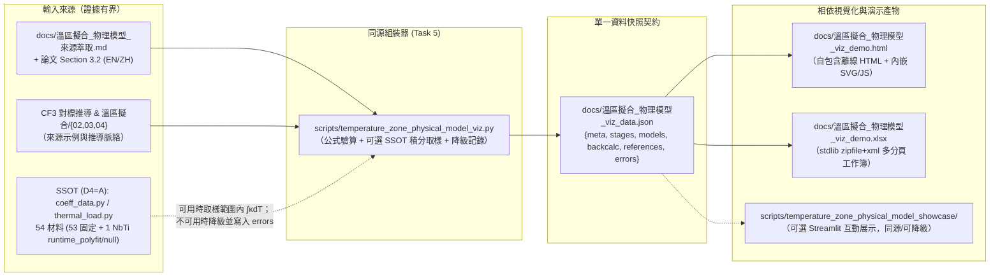

# 溫區擬合 物理模型 — 視覺化規格與資料快照契約

> **主題（Topic）：** 溫區擬合（Temperature-Zone Fitting / Stage-Wise Physical Calculation）物理溫區計算、分溫階導熱積分與正規化長度回推模型  
> **格式定位（`@topic-viz` Step 0）：** **Format F 混合型** — **A 規格/公式與決策邊界** + **C 曲線/溫區分段與積分示意（可選/可降級）** + **E 參數表與計算器式回推契約**  
> **單一真相來源（SSOT, D4=A）：** `~/.opencode/skills/heatload-coff-nist/scripts/coeff_data.py`、`~/.opencode/skills/heatload-coff-nist/scripts/thermal_load.py`（54 筆材料：48 筆 `log_polynomial`、5 筆 `rational_copper`、1 筆 `NbTi (Cri/oFlex 3)` 為 `runtime_polyfit` 且 `coeffs=null`）  
> **核心原則：** **規格先行、資料同源、離線可開、可降級、證據有界（不重擬合、不編造 $\kappa(T)$ 係數、不宣稱新實驗量測）**。

---

## 1. 目標、範圍與全域約束

### 1.1 目標
將 `docs/溫區擬合_物理模型_來源萃取.md` 及 `docs/heatload-distill_paper.md` / `docs/heatload-distill_paper.zh.md` 第 3.2 節所建立之「溫區擬合」物理模型（一維穩態傅立葉分溫階導熱積分、常數 $\kappa$ 與 Wiedemann–Franz $\rho=\text{const}$ 解析特例、溫區熱導積分比正規化長度回推、極低溫退相干閾值與安全長度條件分析），轉化為**單一同源資料快照契約**（`docs/溫區擬合_物理模型_viz_data.json`）與**相依視覺化/演示工具規格**（離線 HTML、Excel 工作簿，以及可選之 `distill-showcase` 慣例 Streamlit 互動展示）。

### 1.2 範圍與非目標（證據有界）
- **納入範圍：**
  1. 稀釋冷凍機典型分溫階邊界（如 $4\text{–}40\text{ K}$、$10\text{–}350\text{ mK}$ 及擴展溫區 $4\text{–}50\text{ K}$ 示例）與幾何/熱負載對標脈絡。
  2. 非線性傅立葉定積分 $Q = \frac{A}{L}\int_{T_c}^{T_h}\kappa(T)\,dT$ 與三種簡化/特例公式（線性平均 $\kappa_{\text{avg}}\Delta T$、Wiedemann–Franz $\rho=\text{const}$ 平方差 $\frac{L_0 A}{2\rho L}(T_h^2-T_c^2)$、含直流焦耳熱 $I^2 R$ 與射頻衰減耗散 $Q_{\text{rf}}$ 銜接）之並排對照與失效邊界。
  3. 溫區熱導積分比（Ratio of Thermal Integrals, $I_{\text{image}}/I_{\text{ref}}$）消去未知複合截面積 $A$ 之正規化長度回推計算器參數表，以及極低溫 Transmon 退相干臨界溫度（$T_{\text{crit}}\approx 57.6\text{ mK}$）下之線性安全長度回推與敏感度對照。
  4. 明確的假設、適用溫度範圍、深低溫外推限制、SSOT 係數政策與執行期 `errors` 降級揭露。
- **非目標 / 嚴格禁止：**
  - **不宣稱新實驗量測：** CF3 規格表數值（$<125\ \mu\text{W}/\text{ch}$、$\sim 20\text{ nW}/\text{ch}$、$0.4\text{ m}$、$0.2\text{ m}$ 等）與 FPC 11 層幾何僅作為**具來源依據之廠商規格對標與推導脈絡（sourced benchmark/derivation context）**，絕不冒充本專案實測數據。
  - **不重擬合、不發明 $\kappa(T)$ 係數：** 嚴守 SSOT D4=A；`NbTi (Cri/oFlex 3)` 在 SSOT 中為 `runtime_polyfit` 且 `coeffs=null`，**排除於固定係數數值關係之外**，禁止賦予固定 9 係數。
  - **不混用定性教學冪次式與 SSOT：** `推導溫區公式.md` 中之分段冪次式僅供物理機制（聲子邊界散射、Wiedemann–Franz、BCS 超導凝聚）定性對照，不得取代 SSOT `log_polynomial` / `rational_copper` 模型。

---

## 2. 輸入來源與輸出產物清單（同源架構）

### 2.1 輸入來源（可追溯路徑）

| 類別 | 檔案路徑 | 角色與提供內容 | 必備/可選 |
|---|---|---|---|
| **核心萃取基準** | `docs/溫區擬合_物理模型_來源萃取.md` | 溫區擬合 5 大物理公式、4 大適用邊界、4 大排除項、與論文 3.2 節銜接定義 | **必備** |
| **論文主稿（EN/ZH）** | `docs/heatload-distill_paper.md`<br>`docs/heatload-distill_paper.zh.md` | Section 2.3（SSOT D4=A）、Section 3.1（$Q_{\text{solid}}, Q_{\text{rf}}$）、Section 3.2（溫區擬合物理計算） | **必備** |
| **物理推導來源 1** | `~/量傳線/三視圖/柔性/驗證/對標CF3規格電性熱負載物理推導.md` | CF3 分溫階基準表（4–40 K, 10–350 mK）、Wiedemann–Franz 定律、線性近似 $Q\approx(\kappa A/L)\Delta T$、FPC 11 層對照 | **必備（來源脈絡）** |
| **物理推導來源 2** | `~/量傳線/溫區擬合/03_熱傳導與熱導率模型/傅立葉導熱定律回推長度.md` | 非線性傅立葉積分 $P=(A/L)\int\kappa dT$、同截面消去 $A$ 正規化、積分比回推 $L=L_{\text{ref}}(P_{\text{ref}}/P_{\text{image}})(I_{\text{image}}/I_{\text{ref}})$（示例比值 $1.48$） | **必備（來源脈絡）** |
| **物理推導來源 3** | `~/量傳線/溫區擬合/03_熱傳導與熱導率模型/基礎推導熱負載.md` | Wiedemann–Franz + $\rho=\text{const}$ 分離變數積分 $Q=\frac{L_0 A}{2\rho L}(T_h^2-T_c^2)=\frac{L_0 T_{\text{avg}}\Delta T}{R}$、焦耳熱 $+I^2 R$ | **必備（來源脈絡）** |
| **物理推導來源 4** | `~/量傳線/溫區擬合/02_極低溫溫區與熱負載/crioFlex3回推量子比特溫區長度.md`<br>`~/量傳線/溫區擬合/04_溫區長度回推與約束/最大安全長度.md` | Transmon 退相干閾值（$f_{01}=5.5\text{ GHz}, P_{|1\rangle}<1\% \Rightarrow T_{\text{crit}}\approx 57.6\text{ mK}$）、線性 $T(x)$ 下 $x_{\text{safe}}\approx 2.8\text{ cm}$ 與 $L_{\text{new}}\approx 35.7\text{ cm}$（及 $\Delta T\propto L^2 \Rightarrow L_{\max}\approx 7.5\text{ cm}$ 對照） | **必備（來源脈絡）** |
| **物理推導來源 5** | `~/量傳線/溫區擬合/04_溫區長度回推與約束/推導溫區公式.md` | Polyimide（聲子/TLS）、Ag（W-F）、NbTi（$T<T_c$ BCS 指數衰減）導熱機制背景（僅定性對照，非 SSOT 係數） | **必備（機制說明）** |
| **SSOT 係數與引擎** | `~/.opencode/skills/heatload-coff-nist/scripts/coeff_data.py`<br>`~/.opencode/skills/heatload-coff-nist/scripts/thermal_load.py`<br>（或專案封裝 `src/量傳線設計/核心/熱負載NIST9.py`） | D4=A 單一真相來源：54 筆材料（53 筆固定係數 + 1 筆 `NbTi (Cri/oFlex 3)` `runtime_polyfit/null`）及範圍內 $\kappa(T)$ / $\int\kappa(T)\,dT$ 計算 | **可選（取樣引擎；缺時降級）** |
| **可靠度與文獻驗證** | `docs/polyfit_可靠度驗證.json`<br>`docs/9coeff_4step_flow.json`<br>`docs/溫區擬合_物理模型_arxiv驗證.md`（Task 7 產出） | 擬合區間積分穩定度 vs 深低溫外推敏感度證據、arXiv/同儕文獻（Smith 2024, Raicu 2025 等）對照 | **可選（輔助同源證據）** |

### 2.2 輸出產物與檔名契約

| 產物角色 | 標準路徑 / 檔名 | 負責任務 | 規格要求 |
|---|---|---|---|
| **視覺化規格書** | `docs/溫區擬合_物理模型_viz_spec.md` | **Task 4（本檔）** | 定義 Format F 視圖/分頁、JSON 資料快照契約、SSOT 邊界與降級策略 |
| **同源資料快照** | `docs/溫區擬合_物理模型_viz_data.json` | **Task 5 腳本權威生成** | 單一資料快照驅動 HTML/Excel/Streamlit；含 `meta`, `stages`, `models`, `backcalc`, `references`, `errors` |
| **快照與離線產生器** | `scripts/temperature_zone_physical_model_viz.py`<br>（相容別名說明：`scripts/溫區擬合_physical_model_viz.py`，以 ASCII 安全路徑為主入口） | **Task 5** | 讀取來源與（可選）SSOT 引擎，組裝 JSON 快照並同時輸出自包含 HTML 與 Excel |
| **離線互動 HTML** | `docs/溫區擬合_物理模型_viz_demo.html` | **Task 5** | 單檔自包含（內嵌 CSS/JS/JSON/SVG，**零外部 CDN**），離線瀏覽器直開 |
| **可攜 Excel 工作簿** | `docs/溫區擬合_物理模型_viz_demo.xlsx` | **Task 5** | 由同一份 `docs/溫區擬合_物理模型_viz_data.json` 驅動；優先以 Python stdlib `zipfile+xml` 生成以確保零第三方套件依賴 |
| **Streamlit 互動展示（選用）** | `scripts/temperature_zone_physical_model_showcase/app.py`<br>`scripts/temperature_zone_physical_model_showcase/src/data.py`<br>`scripts/temperature_zone_physical_model_showcase/src/views/*.py` | **Task 6（選用）** | 遵循 `distill-showcase` 慣例：單一 `app.py` 入口、單次 `st.set_page_config`、強制 `st.radio`/`st.sidebar.radio(..., horizontal=True)`、強制 `with st.expander("<可識別標籤>"):`、強制 `width='stretch'/'content'` |

### 2.3 資料流與同源架構圖



---

## 3. 物理模型與公式規格（Format F：A 規格/公式 + C 曲線/分段 + E 參數表）

本視覺化規格涵蓋之所有計算公式與符號均嚴格錨定 `docs/溫區擬合_物理模型_來源萃取.md`，所有演示工具必須顯式標示**物理單位**、**適用溫度區間**與**成立假設**：

| 模型編號 (`model_id`) | 名稱 | 核心數學公式 | 符號與標準單位 | 成立假設與失效邊界（必顯欄位） | 來源錨點 |
|---|---|---|---|---|---|
| **`M1_fourier_integral`** | 一維穩態非線性傅立葉導熱定積分（分溫階主模型） | $$Q_i = \frac{A}{L_i}\int_{T_{c,i}}^{T_{h,i}}\kappa(T)\,dT = \frac{A}{L_i}I_i$$ $$Q_{\text{solid}} = \sum_i \frac{A_i}{L_i}\int_{T_{c,i}}^{T_{h,i}}\kappa_i(T)\,dT$$ | $Q_i$: 熱負載 $[\text{W}]$（或 $[\mu\text{W}], [\text{nW}]$）<br>$A$: 有效導熱截面積 $[\text{m}^2]$<br>$L_i$: 溫區線段長 $[\text{m}]$<br>$T_{c,i}, T_{h,i}$: 冷/熱端溫度 $[\text{K}]$<br>$\kappa(T)$: 熱導率 $[\text{W}\cdot\text{m}^{-1}\cdot\text{K}^{-1}]$<br>$I_i$: 熱導率定積分 $[\text{W}\cdot\text{m}^{-1}]$ | **假設：** 一維穩態軸向傳導、區間 $(0,L_i)$ 內無中途熱錨分流、無側向輻射耦合、無分散式內部熱源（$q=\text{const}$）。<br>**邊界：** $\kappa(T)$ 僅在 SSOT `valid_range_K`（多數 $\ge 1\text{–}4\text{ K}$）內具擬合支撐；深低溫外推不具驗證物性地位。 | `docs/heatload-distill_paper.md:72-86`<br>`傅立葉導熱定律回推長度.md:5-10` |
| **`M2_linear_avg_kappa`** | 常數/區間平均熱導率線性近似 | $$Q \approx \frac{\kappa_{\text{avg}} A}{L}\Delta T, \quad \Delta T = T_h - T_c$$ $$\kappa_{\text{avg}} = \frac{1}{\Delta T}\int_{T_c}^{T_h}\kappa(T)\,dT$$ | $\Delta T$: 溫區溫差 $[\text{K}]$<br>$\kappa_{\text{avg}}$: 區間平均熱導率 $[\text{W}\cdot\text{m}^{-1}\cdot\text{K}^{-1}]$ | **假設：** 窄溫區（$\Delta T \ll T_{\text{avg}}$）或已知精確區間平均 $\kappa_{\text{avg}}$。<br>**邊界：** 若以單點 $\kappa(T)$ 代替跨數量級溫區（如 $4\text{–}40\text{ K}$）之 $\kappa_{\text{avg}}$，將因低溫 $\kappa(T)$ 強烈非線性而產生顯著偏差；僅供幾何 $A/L$ 比例對標。 | `對標CF3規格電性熱負載物理推導.md:84-90,132`<br>`基礎推導熱負載.md:35-37,87-91` |
| **`M3_wf_const_rho`** | Wiedemann–Franz 電子導熱與常數電阻率（$\rho=\text{const}$）解析特例 | $$\kappa_e(T) = \frac{L_0 T}{\rho} = \sigma L_0 T$$ $$Q = \frac{L_0 A}{2\rho L}\left(T_h^2 - T_c^2\right) = \frac{L_0 T_{\text{avg}}\Delta T}{R}$$ $$T_{\text{avg}} = \frac{T_h+T_c}{2}, \quad R = \frac{\rho L}{A}$$ （含直流偏置時 $+I_{\text{dc}}^2 R$；射頻耗散銜接 $Q_{\text{rf}}$） | $L_0$: Lorenz 常數 $\approx 2.44\times 10^{-8}\ [\text{W}\cdot\Omega\cdot\text{K}^{-2}]$<br>$\rho$: 電阻率 $[\Omega\cdot\text{m}]$<br>$R$: 區間電阻 $[\Omega]$<br>$T_{\text{avg}}$: 算術平均溫度 $[\text{K}]$ | **假設：** 正常態金屬處於極低溫彈性雜質/缺陷散射主導區（$\rho(T)\approx\rho_0=\text{const}$）。<br>**嚴格不適用：** (a) 非晶介電質基材（Polyimide/Kapton，聲子/TLS 主導）；(b) 超導體於臨界溫度以下（如 NbTi 在 $T<T_c\approx 9.2\text{–}9.8\text{ K}$，庫柏對凝聚使 $\kappa_e \propto e^{-\Delta/k_B T}$ 指數衰減，W-F 失效）；(c) 中高溫非彈性電子–聲子散射區（$\rho(T)$ 非定值）。 | `對標CF3規格電性熱負載物理推導.md:76-82`<br>`基礎推導熱負載.md:3-91`<br>`推導溫區公式.md:20-23` |
| **`M4_integral_ratio_backcalc`** | 溫區熱導積分比與面積正規化長度回推 | $$I_{\text{ref}} = \int_{T_{c,\text{ref}}}^{T_{h,\text{ref}}}\kappa(T)\,dT, \quad I_{\text{image}} = \int_{T_{c,\text{image}}}^{T_{h,\text{image}}}\kappa(T)\,dT$$ $$\frac{P_{\text{image}}}{P_{\text{ref}}} = \frac{L_{\text{ref}}}{L}\left(\frac{I_{\text{image}}}{I_{\text{ref}}}\right)$$ $$L = L_{\text{ref}}\left(\frac{P_{\text{ref}}}{P_{\text{image}}}\right)\left(\frac{I_{\text{image}}}{I_{\text{ref}}}\right)$$ | $L_{\text{ref}}, L$: 基準與目標長度 $[\text{m}]$ 或 $[\text{cm}]$<br>$P_{\text{ref}}, P_{\text{image}}$: 基準與目標允許熱負載 $[\text{W}]$ 或 $[\mu\text{W}]$<br>$I_{\text{image}}/I_{\text{ref}}$: 無因次溫區積分修正係數 $[-]$ | **同構前提：** 基準線與目標線必須具備**完全相同的橫截面幾何與材料層疊結構（$A_{\text{image}} = A_{\text{ref}}$）**。<br>**失效邊界：** 跨異構層疊比較（如 CF3 7 層 $300\ \mu\text{m}$ GSG 對比 FPC 11 層 $144.1\ \mu\text{m}$ 含 PTH 導通孔）**不可消去 $A$**，須保留 $\sum_k A_k\int\kappa_k(T)\,dT$。 | `傅立葉導熱定律回推長度.md:7-30` |
| **`M5_mk_qubit_safe_length`** | 極低溫（mK 級）Transmon 退相干閾值與條件式安全長度回推 | $$P_{|1\rangle}(T) = \exp\left(-\frac{hf_{01}}{k_B T}\right), \quad n_{\text{th}}(T) = \frac{1}{e^{hf_{01}/k_B T}-1}$$ $$T_{\text{crit}} = \frac{hf_{01}}{k_B \ln(1/P_{\text{thresh}})}$$ 線性 $T(x)=T_c+(T_h-T_c)\frac{x}{L}$ 假設下： $$x_{\text{safe}} = L\,\frac{T_{\text{crit}}-T_c}{T_h-T_c}, \quad L_{\text{new}}(x_{\text{req}}) = x_{\text{req}}\,\frac{T_h-T_c}{T_{\text{crit}}-T_c}$$ （對照探索式 $\Delta T\propto L^2 \Rightarrow L_{\max}=L\sqrt{\frac{T_{\text{crit}}-T_c}{T_h-T_c}}$） | $f_{01}$: 量子比特頻率 $[\text{GHz}]$（示例 $5.5\text{ GHz}$）<br>$T_{\text{crit}}$: 退相干臨界溫度 $[\text{mK}]$（示例 $P_{|1\rangle}=1\% \Rightarrow 57.6\text{ mK}$）<br>$x_{\text{safe}}, x_{\text{req}}$: 冷端安全區長度 $[\text{cm}]$<br>$L, L_{\text{new}}, L_{\max}$: 傳輸線總長 $[\text{cm}]$ | **高度條件性（僅教學/敏感度示例）：** 線性 $T(x)$ 隱含 $\kappa(T)=\text{const}$ 且無熱錨/無自發熱；實際 mK 區 $\kappa(T)\propto T^\beta$ 導致非線性凹向下分布，且實務依賴分級熱錨與衰減器而非單靠拉長懸空線（$2.8\text{ cm}\to 35.7\text{ cm}$ 與 $\Delta T\propto L^2 \Rightarrow 7.5\text{ cm}$ 反映不同邊界假設）。SSOT 多項式不可外推至 $10\text{–}350\text{ mK}$ 當已驗證物性。 | `最大安全長度.md:5-91`<br>`crioFlex3回推量子比特溫區長度.md:10-159` |

---

## 4. 視覺化視圖與分頁規格（Views & Sheets）

為確保離線 HTML、Excel 工作簿與（選用）Streamlit 互動展示呈現一致敘事，所有工具均須實作以下 **4 個核心視圖/分頁（V1–V4）**（可選附加 V5 參考文獻與溯源明細）：

### 4.1 視圖總覽表

| 視圖代號 | 視圖標題（必備主題） | 格式角色 | 對應 JSON 快照欄位 | 離線 HTML 呈現元件 | Excel 工作簿分頁（Sheet 名稱） | Streamlit 展示視圖模組（選用，Task 6） |
|---|---|---|---|---|---|---|
| **V1** | **溫區分段與邊界溫度**<br>（Stage-Wise Temperature Zones & Boundary Conditions） | A 規格 + C 分段示意 + E 參數表 | `meta`, `stages` | 稀釋冷凍機溫階分段 SVG 示意圖（50K/40K → 4K → 350mK → 10mK + $T_{\text{crit}}\approx 57.6\text{ mK}$ 標記）+ 溫階基準參數與對標脈絡表（明確標註「來源規格/推導脈絡，非新量測」） | `1_溫區分段與邊界` | `src/views/overview.py` |
| **V2** | **$Q=(A/L)\int\kappa dT$ 與簡化公式對照**<br>（Fourier Integral vs. Simplified Analytical Models） | A 公式 + C 曲線/積分示意（可選/可降級） | `models` | 5 大模型（M1–M5）公式對照卡片、適用/禁用材料矩陣（正常態金屬 Ag/Cu vs 介電質 Kapton vs 超導 NbTi $T<T_c$）、SSOT 範圍內 $\kappa(T)$ / $\int\kappa dT$ 取樣或文件示例點 SVG 圖（含降級標記） | `2_公式對照與適用邊界` | `src/views/models.py` |
| **V3** | **溫區積分比 / 長度回推計算器式參數表**<br>（Integral-Ratio & Safe-Length Back-Calculation Tables） | E 參數表 + C 敏感度比較 | `backcalc` | **(3A)** 同截面溫區積分比長度回推參數表與互動/靜態驗算面板（$L = L_{\text{ref}}(P_{\text{ref}}/P_{\text{image}})(I_{\text{image}}/I_{\text{ref}})$，含 $40\text{ K}\to 4\text{ K}$ 對 $50\text{ K}\to 4\text{ K}$ 比值 $1.48$ 示例及異構層疊不可消去 $A$ 警示）；<br>**(3B)** mK 級 Transmon 退相干閾值（$57.6\text{ mK}$）與三種邊界假設（線性 $x_{\text{safe}}=2.8\text{ cm}$、線性延長 $L_{\text{new}}=35.7\text{ cm}$、二次自發熱 $L_{\max}=7.5\text{ cm}$）比較表與 $T(x)$ 示意圖 | `3_積分比與長度回推表` | `src/views/backcalc.py` |
| **V4** | **假設、適用限制、溯源與 `errors` 欄位**<br>（Assumptions, Extrapolation Limits, Provenance & `errors`） | A 邊界規格 + B 可靠度/錯誤揭露 | `meta.assumptions`, `meta.provenance`, `references`, `errors` | 5 大物理假設與外推限制清單、SSOT D4=A 狀態橫幅（53 固定係數 vs `NbTi (Cri/oFlex 3)` `runtime_polyfit/null`）、來源檔案/文獻溯源表、以及 `errors` / 降級狀態檢視器 | `4_假設限制與錯誤來源` | `src/views/overview.py`（或獨立 expander / `limitations.py`） |

### 4.2 各視圖必備細節要求

1. **V1（溫區分段與邊界溫度）：**
   - 必須列出基準溫區 `stage_40k_4k`（$T_h=40\text{ K}, T_c=4\text{ K}, \Delta T=36\text{ K}, L_{\text{ref}}=0.4\text{ m}$, 對標熱負載上限 $<125\ \mu\text{W}/\text{ch}$）、擴展目標溫區 `stage_50k_4k_target`（$T_h=50\text{ K}, T_c=4\text{ K}, \Delta T=46\text{ K}$, 示例積分比 $I_{\text{image}}/I_{\text{ref}}=1.48$）、以及極低溫區 `stage_350mk_10mk`（$T_h=0.35\text{ K}, T_c=0.01\text{ K}, \Delta T=0.34\text{ K}, L_{\text{ref}}=0.2\text{ m}$, 對標熱負載 $\sim 20\text{ nW}/\text{ch}$）。
   - 每一列必須包含 `data_role: "sourced_benchmark_context"` 標籤與來源路徑，嚴禁標示為「實測值」。
2. **V2（$Q=(A/L)\int\kappa dT$ 與簡化公式對照）：**
   - 並排展示 `M1_fourier_integral`（通式）、`M2_linear_avg_kappa`（常數/平均 $\kappa$）、`M3_wf_const_rho`（W-F + $\rho=\text{const}$ 平方差），並附材料機制對照表（Polyimide 聲子/TLS、Ag 低溫 W-F、NbTi $T<T_c$ BCS 指數抑制）。
   - 若提供曲線或積分取樣點（Format C），必須標明每個點的 `value_origin` 為 `"ssot_in_range_eval"`（由 SSOT 於 `valid_range_K` 內計算）或 `"doc_listed_example"`（文件列舉之示例點），且禁止對 `NbTi (Cri/oFlex 3)` 賦予固定 9 係數。
3. **V3（溫區積分比/長度回推計算器式參數表）：**
   - **子表 A（溫區積分比回推）：** 欄位至少含 `case_id`, `description`, `T_c_ref_K`, `T_h_ref_K`, `T_c_image_K`, `T_h_image_K`, `L_ref_m`, `P_ref_uW`, `P_image_uW`, `integral_ratio_I_image_over_I_ref`, `ratio_origin`, `L_backcalc_m`, `area_cancellation_valid`, `assumption_note`。必須收錄來源文件基準案例（$L_{\text{ref}}=0.40\text{ m}, I_{\text{image}}/I_{\text{ref}}=1.48$：當要求 $P_{\text{image}}=P_{\text{ref}}=125\ \mu\text{W}$ 時回推所需長度 $L=0.40\times 1.0\times 1.48 = 0.592\text{ m}$ ($59.2\text{ cm}$)；或當保持 $L=L_{\text{ref}}=0.40\text{ m}$ 時對應熱負載比例 $P_{\text{image}}/P_{\text{ref}}=1.48$），以及異構層疊（CF3 7 層 $300\ \mu\text{m}$ vs FPC 11 層 $144.1\ \mu\text{m}$）不可消去 $A$ 之反例列（`area_cancellation_valid: false`, `L_backcalc_m: null`）。
   - **子表 B（mK 級量子比特安全長度回推與假設敏感度）：** 欄位至少含 `case_id`, `f01_GHz`, `occupancy_threshold`, `T_crit_mK`, `T_c_mK`, `T_h_mK`, `L_orig_cm`, `profile_assumption`, `x_safe_cm`, `x_req_cm`, `L_result_cm`, `physical_caveat`。完整呈現 $2.8\text{ cm}$（$L=20\text{ cm}$ 線性安全區）、$35.7\text{ cm}$（要求 $x_{\text{req}}=5\text{ cm}$ 之線性延長回推）與 $7.5\text{ cm}$（$\Delta T\propto L^2$ 探索模型上限）三組推導結果及其邊界條件差異。
4. **V4（假設與限制 / `errors` 欄位）：**
   - 完整呈現 5 項核心限制（一維穩態無中途熱錨、同截面同構消去 $A$、W-F 正常態金屬彈性散射限制、mK 線性溫度分布強假設、SSOT $\ge 1\text{–}4\text{ K}$ 有效範圍與深低溫外推禁止當定論）。
   - 顯式渲染頂層 `errors` 陣列與各模型/取樣之降級狀態（若 `errors` 為空陣列 `[]`，顯示「`errors: 0`（無未處理錯誤；示例點與 SSOT 取樣狀態均已標註）」；若有降級項目，逐筆列出 `code`, `stage`, `message`, `fallback_used`）。

---

## 5. 資料快照契約（`docs/溫區擬合_物理模型_viz_data.json` Schema）

> **權威生成原則：** 為避免手寫雙份快照造成漂移，本節定義完整 JSON 資料契約與型別/欄位規範；權威快照檔 `docs/溫區擬合_物理模型_viz_data.json` 由 Task 5 腳本 `scripts/temperature_zone_physical_model_viz.py` 依本契約生成（若在任何測試環境先建立手寫範本，必須於 `meta.generated_by` 標註 `"manual_template_non_authoritative"`；Task 5 正式產物則標註 `"scripts/temperature_zone_physical_model_viz.py"`）。

### 5.1 頂層結構（Required Top-Level Keys）

快照 JSON **必須**包含以下 6 個頂層鍵：`meta`、`stages`、`models`、`backcalc`、`references`、`errors`（可選附加 `samples` 置於 `models` 內或頂層供 Format C 繪圖使用）：

```json
{
  "meta": {
    "title": "溫區擬合 物理模型 — 同源視覺化資料快照",
    "topic": "temperature_zone_physical_model",
    "format": "F_hybrid (A_spec_formula + C_curve_stage_optional + E_param_tables)",
    "generated_at": "2026-11-20T00:00:00Z",
    "generated_by": "scripts/temperature_zone_physical_model_viz.py",
    "ssot_decision": "D4=A",
    "source": {
      "primary_extraction_doc": "docs/溫區擬合_物理模型_來源萃取.md",
      "paper_en": "docs/heatload-distill_paper.md#3.2",
      "paper_zh": "docs/heatload-distill_paper.zh.md#3.2",
      "derivation_notes": [
        "三視圖/柔性/驗證/對標CF3規格電性熱負載物理推導.md",
        "溫區擬合/03_熱傳導與熱導率模型/傅立葉導熱定律回推長度.md",
        "溫區擬合/03_熱傳導與熱導率模型/基礎推導熱負載.md",
        "溫區擬合/02_極低溫溫區與熱負載/crioFlex3回推量子比特溫區長度.md",
        "溫區擬合/04_溫區長度回推與約束/最大安全長度.md",
        "溫區擬合/04_溫區長度回推與約束/推導溫區公式.md"
      ],
      "ssot_scripts": [
        "~/.opencode/skills/heatload-coff-nist/scripts/coeff_data.py",
        "~/.opencode/skills/heatload-coff-nist/scripts/thermal_load.py"
      ]
    },
    "provenance": {
      "ssot_available": true,
      "ssot_material_count_total": 54,
      "ssot_fixed_coeff_count": 53,
      "ssot_equation_Breakdown": {
        "log_polynomial": 48,
        "rational_copper": 5,
        "runtime_polyfit": 1
      },
      "excluded_runtime_fit_material": {
        "name": "NbTi (Cri/oFlex 3)",
        "equation_type": "runtime_polyfit",
        "coeffs": null,
        "policy": "Excluded from fixed-coefficient numeric relations; no invented 9 coefficients."
      },
      "benchmark_data_policy": "CF3 and FPC numbers are sourced specification/derivation context only, NOT new experimental measurements."
    },
    "units": {
      "temperature": "K (or mK where explicitly suffixed _mK)",
      "length": "m (or cm where explicitly suffixed _cm)",
      "cross_section_area": "m^2",
      "thermal_conductivity_kappa": "W/(m·K)",
      "thermal_integral_I": "W/m",
      "heat_load_Q_or_P": "W (or uW / nW where explicitly suffixed)",
      "electrical_resistivity_rho": "Ohm·m",
      "electrical_resistance_R": "Ohm",
      "lorenz_number_L0": "W·Ohm/K^2",
      "frequency_f01": "GHz"
    },
    "assumptions": [
      {
        "id": "A1_steady_1d_no_intermediate_anchor",
        "title": "一維穩態軸向導熱且區間內無中途熱錨/側向輻射/分散式熱源",
        "applies_to": ["M1_fourier_integral", "M2_linear_avg_kappa", "M3_wf_const_rho", "M4_integral_ratio_backcalc"],
        "violation_effect": "若存在中途熱錨分流或顯著射頻衰減自發熱 Q_rf，熱通量 q(x) 不再為常數，單一區間定積分需拆分為分段耦合或含內熱源微分方程。"
      },
      {
        "id": "A2_homogeneous_cross_section_cancellation",
        "title": "基準線與目標線具完全相同之橫截面幾何與材料層疊 (A_image = A_ref)",
        "applies_to": ["M4_integral_ratio_backcalc"],
        "violation_effect": "跨異構層疊（如 CF3 7 層 300 um GSG 對比 FPC 11 層 144.1 um 含導通孔）不可消去 A，須顯式計算各層 Σ A_k ∫ κ_k(T) dT。"
      },
      {
        "id": "A3_normal_metal_elastic_scattering_const_rho",
        "title": "正常態金屬低溫殘餘雜質彈性散射區 (ρ(T) ≈ ρ_0 = const)",
        "applies_to": ["M3_wf_const_rho"],
        "violation_effect": "不適用於非晶介電質 (Kapton/Polyimide)、不適用於超導態 (NbTi 於 T < Tc ≈ 9.2–9.8 K 電子導熱指數衰減)、亦不適用於中高溫電子–聲子非彈性散射區。"
      },
      {
        "id": "A4_linear_temperature_profile_mk",
        "title": "極低溫區常數熱導率與無熱錨線性溫度分布 T(x) = T_c + (T_h - T_c)(x/L)",
        "applies_to": ["M5_mk_qubit_safe_length"],
        "violation_effect": "mK 溫區 κ(T) 隨溫度冪次/指數變化，穩態 κ(T)dT/dx=const 產生非線性凹向下分布；實務依賴分級熱錨與濾波/衰減器，2.8 cm / 35.7 cm / 7.5 cm 僅供假設敏感度教學對照。"
      },
      {
        "id": "A5_ssot_valid_range_and_extrapolation_limit",
        "title": "SSOT 擬合有效溫度範圍 (valid_range_K，多數 ≥ 1–4 K) 與深低溫外推邊界",
        "applies_to": ["M1_fourier_integral", "M4_integral_ratio_backcalc", "M5_mk_qubit_safe_length"],
        "violation_effect": "將 ≥ 1–4 K 多項式或端點冪次 k(T)~T^α 外推至 10–350 mK 屬高度敏感之範圍外推（如驗證報告中 k(20 mK) 隨微擾變動達 ~2 倍且量級失真），嚴禁當作已驗證材料物性。"
      }
    ]
  },
  "stages": [],
  "models": {},
  "backcalc": {},
  "references": [],
  "errors": []
}
```

### 5.2 各頂層欄位詳細規範

1. **`meta`（元資料、溯源、假設與單位契約）：**
   - 必含子鍵：`title`, `topic`, `format`, `generated_at`, `generated_by`, `ssot_decision` (`"D4=A"`), `source`（來源路徑字典）, `provenance`（SSOT 54/53/1 狀態與對標數據政策）, `units`（所有物理量單位字典）, `assumptions`（A1–A5 結構化假設與失效影響清單）。
2. **`stages`（溫區分段與邊界溫度清單，對應 V1）：**
   - 型別：`Array<Object>`。
   - 每筆元素必含欄位：
     - `stage_id` (`string`，如 `"cf3_40k_to_4k_ref"`, `"target_50k_to_4k_expanded"`, `"cf3_350mk_to_10mk_ref"`, `"fpc_11layer_heterogeneous_ref"`)
     - `label` (`string`)
     - `T_hot_K` (`number`)、`T_cold_K` (`number`)、`delta_T_K` (`number`)
     - `length_m` (`number | null`)、`length_cm` (`number | null`)
     - `benchmark_heat_load` (`{"value": number, "unit": "uW/ch" | "nW/ch", "sense": "upper_bound" | "typical_approx"} | null`)
     - `geometry_context` (`string`，如 `"CF3 7-layer GSG flex, total thickness ~300 um"` 或 `"FPC 11-layer stack-up, total thickness ~144.1 um with PTH"`)
     - `data_role` (`"sourced_benchmark_context"` | `"derivation_target_example"`)
     - `source_ref` (`string`，精確至檔案路徑與章節/行號)
     - `notes` (`string`)
3. **`models`（物理模型公式對照與曲線/積分示例，對應 V2）：**
   - 型別：`Object`，必含：
     - `catalog` (`Array<Object>`)：收錄 `M1_fourier_integral`、`M2_linear_avg_kappa`、`M3_wf_const_rho`、`M4_integral_ratio_backcalc`、`M5_mk_qubit_safe_length`，每筆含 `model_id`, `name_zh`, `name_en`, `formula_latex`, `variables`, `valid_regime`, `invalid_regimes`, `material_applicability`（對 `normal_metal_Ag_Cu`, `amorphous_dielectric_Kapton`, `superconductor_NbTi_below_Tc` 的適用性標記與原因）, `source_ref`。
     - `constants` (`Object`)：如 `L0_W_Ohm_per_K2: 2.44e-8`, `h_J_s: 6.62607015e-34`, `kB_J_per_K: 1.380649e-23`。
     - `curve_and_integral_samples` (`Object`)：
       - `sampling_mode`: `"ssot_engine_plus_doc_examples"` 或 `"doc_listed_examples_only_fallback"`（視執行期 SSOT 可用性自動設定）。
       - `doc_example_points` (`Array<Object>`)：直接萃取自來源文件之定點/積分比示例（例如 $40\text{ K}\to 4\text{ K}$ 對 $50\text{ K}\to 4\text{ K}$ 之 $I_{\text{image}}/I_{\text{ref}}=1.48$；以及 `polyfit_可靠度驗證.json` 中已記錄之 Kapton $\int_2^{300}\kappa\,dT \approx 28.907\ \text{W/m}$ 等），每筆必標註 `value_origin: "doc_listed_example"` 與 `source_ref`。
       - `ssot_in_range_samples` (`Array<Object>`)：當 SSOT 腳本可載入時，於**有效溫度區間內**（如 Kapton 或 OFHC Cu 在 $4\text{–}40\text{ K}$ 及 $4\text{–}50\text{ K}$）取樣之 $\kappa(T)$ 曲線點與區間積分 $I = \int_{T_c}^{T_h}\kappa(T)\,dT$ 對照值，每筆必標註 `value_origin: "ssot_in_range_eval"`, `material_name`, `valid_range_K`, `extrapolated: false`；若 SSOT 不可用則為空陣列 `[]` 並於 `errors` 記錄降級。
4. **`backcalc`（溫區積分比與極低溫安全長度回推計算器式參數表，對應 V3）：**
   - 型別：`Object`，必含三個子區塊：
     - `integral_ratio_calculator`:
       - `formula_latex`: `"L = L_{\\text{ref}}\\left(\\frac{P_{\\text{ref}}}{P_{\\text{image}}}\\right)\\left(\\frac{I_{\\text{image}}}{I_{\\text{ref}}}\\right)"`
       - `prerequisite`: `"A_image == A_ref (identical cross-section geometry and material stack-up)"`
       - `cases` (`Array<Object>`)：至少包含：
         1. `case_40k_to_50k_equal_power`（基準 $40\text{ K}\to 4\text{ K}, L_{\text{ref}}=0.40\text{ m}, P_{\text{ref}}=125\ \mu\text{W}$ 擴展至 $50\text{ K}\to 4\text{ K}$，採文件示例積分比 $I_{\text{image}}/I_{\text{ref}}=1.48$ 且維持 $P_{\text{image}}=125\ \mu\text{W} \Rightarrow L=0.592\text{ m}$ ($59.2\text{ cm}$)，`value_origin: "doc_listed_example_ratio"`）；
         2. `case_40k_to_50k_equal_length`（同上基準與積分比 $1.48$，若維持 $L=L_{\text{ref}}=0.40\text{ m}$，則熱負載升為 $P_{\text{image}}=125\times 1.48 = 185.0\ \mu\text{W}$）；
         3. `case_ssot_reference_material_40k_50k`（若 SSOT 可用，附上 SSOT 固定係數代表材料在 $4\text{–}50\text{ K}$ 對 $4\text{–}40\text{ K}$ 之實算 $I_{\text{image}}/I_{\text{ref}}$ 對照列，標註 `value_origin: "ssot_in_range_eval"`；若 SSOT 不可用則標註 `status: "degraded_to_doc_example"`）；
         4. `case_heterogeneous_cf3_vs_fpc_invalid`（CF3 7 層 $300\ \mu\text{m}$ vs FPC 11 層 $144.1\ \mu\text{m}$ 異構對照：`area_cancellation_valid: false`, `L_backcalc_m: null`，說明必須保留分層面積 $\sum_k A_k\int\kappa_k dT$）。
     - `qubit_mk_safe_length_calculator`:
       - `transmon_params`: `{"f01_GHz": 5.5, "anharmonicity_MHz": -250, "T_equiv_f01_mK": 263.96, "occupancy_threshold": 0.01, "T_crit_mK": 57.6}`
       - `cases` (`Array<Object>`)：至少包含：
         1. `mk_linear_baseline_20cm`（$T_c=10\text{ mK}, T_h=350\text{ mK}, L=20\text{ cm}$，線性 $T(x)$ 假設下 $x_{\text{safe}} = 20\times(57.6-10)/(350-10) \approx 2.80\text{ cm}$）；
         2. `mk_linear_extend_for_5cm_safe`（要求冷端安全區 $x_{\text{req}}=5.0\text{ cm}$，線性 $T(x)$ 回推總長 $L_{\text{new}} = 5.0\times 340/47.6 \approx 35.71\text{ cm}$）；
         3. `mk_quadratic_self_heating_exploratory`（探索性分散式自發熱 $\Delta T\propto L^2$ 假設下 $L_{\max} = 20\sqrt{47.6/340} \approx 7.48\text{ cm}$）；
         4. `mk_staged_thermal_anchor_practical`（實務多級熱錨與濾波/衰減器配置說明：定性指出不應單靠拉長無熱錨懸空線段，須於中間溫階熱化）。
     - `temperature_profile_comparison` (`Object`)：提供冷端至熱端正規化座標 $\xi = x/L \in [0, 1]$ 上之「簡化線性分布 $T_{\text{linear}}(\xi)$」與「定性冪次導熱 $\kappa(T)\propto T^\beta$（如 $\beta=1, 2$）守恆下之非線性凹向下分布 $T_{\text{nonlinear}}(\xi)=\left[T_c^{\beta+1}+\xi(T_h^{\beta+1}-T_c^{\beta+1})\right]^{1/(\beta+1)}$」對照點，並明確標註為**理論邊界敏感度示意（analytical sensitivity schematic，非 SSOT mK 實測）**。
5. **`references`（可追溯來源清單，對應 V4/V5）：**
   - 型別：`Array<Object>`，每筆含 `ref_id`, `category` (`"project_derivation_note"` | `"ssot_script"` | `"paper_section"` | `"peer_reviewed_or_arxiv"`), `title`, `path_or_citation`, `role_in_model`, `verification_status` (`"verified_local_file"` | `"verified_literature_metadata"` | `"pending_task7_arxiv"`).
   - **已驗證外部文獻基線（Task 7 `docs/溫區擬合_物理模型_arxiv驗證.md`）：** `references` 陣列中屬於 `"peer_reviewed_or_arxiv"` 且 `verification_status: "verified_literature_metadata"` 之條目，應收錄以下經 `arxiv-search` 實時檢索與專案引用交叉核對之文獻（不杜撰未查核欄位）：
     - `raicu_2025`: Raicu, N. et al. (2025), *"Cryogenic Thermal Modeling of Microwave High Density Signaling"*, *EPJ Quantum Technology* 12, 124 (`arXiv:2502.01945v3`, DOI: `10.1140/epjqt/s40507-025-00427-1`, Zenodo: `10.5281/zenodo.15238913`) — 支持分溫階靜態傅立葉導熱積分、9 參數對數多項式 $\kappa(T)$ / $\rho(T)$ 擬合與低溫殘餘電阻率常數區建模。
     - `smith_2024`: Smith, J. P. et al. (2024), *"Improved Flexible Coaxial Ribbon Cable for High-Density Superconducting Arrays"*, *IEEE Trans. Appl. Supercond.* 34(2), 1–6 (`arXiv:2306.13574v2`, DOI: `10.1109/TASC.2024.3350516`) 與前作 `smith_2020` (`arXiv:2007.06496v1`, DOI: `10.1109/TASC.2020.3008591`) — 支持超導 Nb47Ti 柔性排線跨溫階（$1\text{ K}\to 90\text{–}100\text{ mK}$）nW 級被動導熱積分估算與多層幾何加權。
     - `krinner_2019`: Krinner, S. et al. (2019), *"Engineering cryogenic setups for 100-qubit scale superconducting circuit systems"*, *EPJ Quantum Technology* 6, 2 (`arXiv:1806.07862v1`, DOI: `10.1140/epjqt/s40507-019-0072-0`) 與 `paluch_2024`: Paluch, P. et al. (2024), *"Thermalization of a flexible microwave stripline measured by a superconducting qubit"* (`arXiv:2410.01053v1`) — 支持分溫階被動/主動熱預算管理，並證實毫克耳文量子比特熱化（殘餘熱光子數與有效溫度控制）依賴各溫階熱錨與分佈式衰減器，而非未錨定懸空線段之線性溫度分布。
     - `wf_low_temp_refs`: Sologubenko, A. V. et al. (2006) (`arXiv:cond-mat/0608143v2`, *Phys. Rev. B* 74, 184523)、Graf, M. J. et al. (1996) (`arXiv:cond-mat/9509046v1`, *Phys. Rev. B* 53, 15147)、Hu, Y. et al. (2021) (`arXiv:2011.07707v1`, *Phys. Rev. B* 103, 104301) 與 Behnia, K. et al. (2025) (`arXiv:2503.13968v1`) — 界定低溫彈性雜質散射極限下 Wiedemann–Franz 定律之有效性，以及超導配對凝聚、奈米薄膜尺寸/晶界散射與極低溫電子–聲子解耦帶來之適用限制。
6. **`errors`（降級與錯誤記錄，對應 V4）：**
   - 型別：`Array<Object>`。
   - 若所有必備文件與可選 SSOT 取樣均成功，為空陣列 `[]`。
   - 若發生任何可選來源缺失、SSOT 載入失敗、或選用套件（如 `openpyxl`、`streamlit`）缺席導致降級，每筆錯誤記錄格式為：
     ```json
     {
       "code": "SSOT_ENGINE_UNAVAILABLE",
       "severity": "warning_degraded",
       "component": "models.curve_and_integral_samples",
       "message": "無法載入 SSOT thermal_load.py 即時計算 ∫κdT，已降級使用來源文件列舉之示例點與既有驗證報告數值。",
       "fallback_used": "doc_listed_examples_only_fallback",
       "timestamp": "2026-11-20T00:00:00Z"
     }
     ```

---

## 6. 降級策略（Graceful Degradation Policy）

為確保在任何執行環境下均能產出可驗證、不編造的演示結果，Task 5 / Task 6 實作必須遵循以下四級降級規則：

1. **無即時 $\kappa(T)$ / $\int\kappa(T)\,dT$ 計算引擎時之降級（核心要求）：**
   - 若執行環境無法匯入 `~/.opencode/skills/heatload-coff-nist/scripts/{coeff_data,thermal_load}.py` 或 `src/量傳線設計/核心/熱負載NIST9.py`（或缺少 `numpy`）：
   - **禁止**在腳本內硬編碼偽造新的 9 係數或自行呼叫 `polyfit` 重擬合。
   - **降級行為：** 自動將 `models.curve_and_integral_samples.sampling_mode` 設為 `"doc_listed_examples_only_fallback"`，使用來源文件已明確列舉之示例點（如 `傅立葉導熱定律回推長度.md` 之 $I_{\text{image}}/I_{\text{ref}}=1.48$、`對標CF3規格電性熱負載物理推導.md` 之 $4\text{–}40\text{ K}$ / $10\text{–}350\text{ mK}$ 基準值、`最大安全長度.md` 之 $T_{\text{crit}}\approx 57.6\text{ mK}, x_{\text{safe}}\approx 2.8\text{ cm}, L_{\text{new}}\approx 35.7\text{ cm}$，以及 `docs/polyfit_可靠度驗證.json` 已存檔之區間積分值），在每筆數據標註 `value_origin: "doc_listed_example"`，並將原因寫入頂層 `errors`。
2. **深低溫（$10\text{–}350\text{ mK}$）區間之強制降級（物理邊界保護）：**
   - 即使 SSOT 引擎可用，由於 SSOT 固定係數材料之 `valid_range_K` 下限通常為 $1\text{–}4\text{ K}$，且 `NbTi (Cri/oFlex 3)` 為 `runtime_polyfit`（`coeffs=null`），**嚴禁**呼叫 SSOT 多項式在 $10\text{–}350\text{ mK}$ 進行外推積分來冒充真實熱負載。
   - 該溫區一律採用來源文件之條件式解析模型（線性 $T(x)$ 與冪次 $\kappa(T)\propto T^\beta$ 敏感度示意）並標註 `"analytical_sensitivity_example_out_of_ssot_range"`。
3. **Excel 產生器之套件降級：**
   - `scripts/temperature_zone_physical_model_viz.py` 產生 `docs/溫區擬合_物理模型_viz_demo.xlsx` 時，優先使用 Python 標準庫 `zipfile` + `xml.etree.ElementTree`（或於 `openpyxl` 可用時相容輸出），確保在無 `openpyxl` / `xlsxwriter` 的環境下仍可 100% 產出合法 `.xlsx` 工作簿，不因缺套件而中斷。
4. **Streamlit 互動展示之環境降級（Task 6）：**
   - 若環境未安裝 `streamlit`，`scripts/temperature_zone_physical_model_showcase/` 仍須通過 `python3 -m py_compile` 靜態語法檢查，並在報告與規格中誠實揭露「互動執行未驗證（缺 `streamlit` 相依）」，由離線自包含 `docs/溫區擬合_物理模型_viz_demo.html` 與 `.xlsx` 承擔完整展示功能。

---

## 7. 假設、適用限制與不確定性聲明（必顯於所有產物）

所有由本規格衍生之 HTML、Excel 與 Streamlit 視圖，均須在顯眼位置（如 V4 專頁與各表頁尾註記）完整呈現以下限制聲明：

1. **來源規格脈絡 vs. 實驗量測區隔：** 所有 CF3 與 FPC 數值（$<125\ \mu\text{W}/\text{ch}$、$\sim 20\text{ nW}/\text{ch}$、$L=0.4\text{ m}/0.2\text{ m}$、層疊厚度等）均引自專案內部對標推導筆記所載之廠商規格脈絡，**並非本專案或本論文之新實驗量測**。
2. **SSOT D4=A 與 `NbTi (Cri/oFlex 3)` 排除規則：** 熱導率 $\kappa(T)$ 9 參數模型唯一真值來源為 `~/.opencode/skills/heatload-coff-nist/scripts/{coeff_data,thermal_load}.py`（54 筆材料中 53 筆具固定係數；`NbTi (Cri/oFlex 3)` 為 `runtime_polyfit` 且 `coeffs=null`，無固定係數且排除於固定係數數值關係之外）。
3. **同截面消去 $A$ 之嚴格同構限制：** 積分比回推公式 $L = L_{\text{ref}}(P_{\text{ref}}/P_{\text{image}})(I_{\text{image}}/I_{\text{ref}})$ 僅在 $A_{\text{image}} = A_{\text{ref}}$（同構橫截面與相同材料層疊）下成立；跨異構排線（如 7 層 GSG 對比 11 層含 PTH 之 FPC）直接套用將導致嚴重誤差。
4. **Wiedemann–Franz $\rho=\text{const}$ 平方差公式之材料與溫區限制：** $Q = \frac{L_0 A}{2\rho L}(T_h^2 - T_c^2)$ 僅適用於正常態金屬低溫殘餘散射區；對非晶介電質（Kapton）、超導態（NbTi 於 $T < T_c \approx 9.2\text{–}9.8\text{ K}$）及中高溫非彈性散射區均不成立。
5. **極低溫 $T(x)$ 線性回推（$2.8\text{ cm}$ / $35.7\text{ cm}$ / $7.5\text{ cm}$）之高度條件性：** 毫克耳文溫區之安全長度回推高度依賴邊界條件假設（常數 $\kappa$ 線性分布 vs 分散式自發熱 $\Delta T\propto L^2$ vs 實務多級熱錨與微波濾波/衰減器），僅作為模型假設敏感度對照，不可作為單一懸空線段之通用硬體設計定論。

---

## 8. 驗證與重現命令規格（供 Task 5 / Task 6 執行驗收）

```bash
cd ~/量傳線

# 1. 規格文件自檢（Task 4）
sed -n '1,260p' docs/溫區擬合_物理模型_viz_spec.md

# 2. 產生器語法檢查與執行（Task 5）
python3 -m py_compile scripts/temperature_zone_physical_model_viz.py
python3 scripts/temperature_zone_physical_model_viz.py

# 3. 快照 JSON 合法性與離線產物檢查（Task 5）
python3 -m json.tool docs/溫區擬合_物理模型_viz_data.json >/dev/null && echo "JSON_OK"
ls -lh docs/溫區擬合_物理模型_viz_data.json docs/溫區擬合_物理模型_viz_demo.html docs/溫區擬合_物理模型_viz_demo.xlsx

# 4. 選用 Streamlit 互動展示靜態檢查（Task 6）
python3 -m py_compile \
  scripts/temperature_zone_physical_model_showcase/app.py \
  scripts/temperature_zone_physical_model_showcase/src/data.py \
  scripts/temperature_zone_physical_model_showcase/src/views/*.py
```
